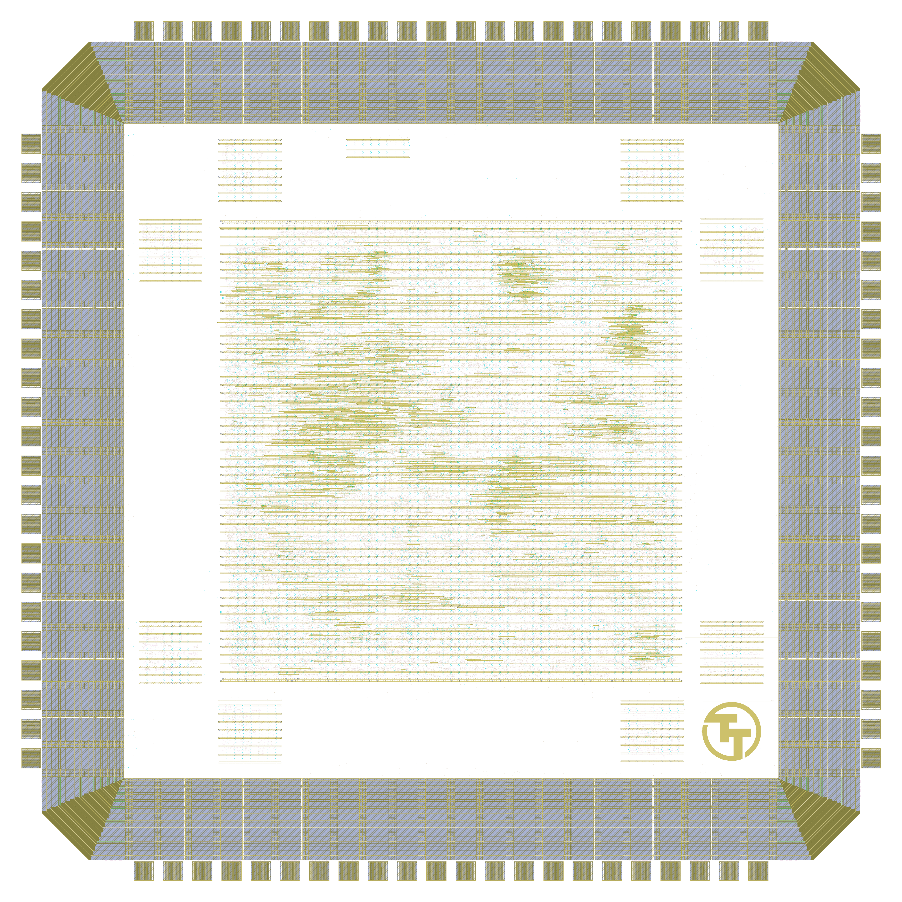

# Tiny Tapeout GF 0.1

[Tiny Tapeout](https://tinytapeout.com/)'s first GF180MCU chip, made on a GlobalFoundries private MPW run: 24 projects in one shared block, beside eight standard cell tests. From [tinytapeout-gf-0p1](https://github.com/TinyTapeout/tinytapeout-gf-0p1) release [`v23`](https://github.com/TinyTapeout/tinytapeout-gf-0p1/releases/tag/v23).

- Chip ID: ttgf0p1
- Made on: a GlobalFoundries private MPW run
- Process: GF180MCU
- Die: 2.935 x 2.935 mm
- Number of projects: 24

<table width="100%">
  <tr>
  <td width="50%"></td>
  <td width="50%"></td>
  </tr>
</table>

Unlike the later Tiny Tapeout chips, the projects do not have tiles of their own: they were synthesised and placed together as one block (`MAIN`), so each project's size below is counted from that block's netlist. See [PROVENANCE.md](PROVENANCE.md) for where everything here comes from.

# Blocks

| Code | Block | Size | Details |
|---|---|---|---|
| MAIN | The 24 Tiny Tapeout projects | 1.6 x 1.6 mm | Every project, synthesised and placed together as one block behind the multiplexer that selects one project at a time |
| CEL0 | Cell test: GF 7-track 5 V cells | 0.225 x 0.225 mm | Standard cell test in the foundry's 7-track 5 V library (gf180mcu_fd_sc_mcu7t5v0). A chain of 1,024 inverters delays a Manchester-coded counter, so the speed of the cells can be measured on the chip from its output pin; each pair of cell tests has a core supply of its own. |
| CEL1 | Cell test: GF 9-track 5 V cells | 0.225 x 0.225 mm | Standard cell test in the foundry's 9-track 5 V library (gf180mcu_fd_sc_mcu9t5v0). A chain of 1,024 inverters delays a Manchester-coded counter, so the speed of the cells can be measured on the chip from its output pin; each pair of cell tests has a core supply of its own. |
| CEL2 | Cell test: GF 7-track cells as 3.3 V transistors | 0.225 x 0.225 mm | Standard cell test in the foundry's 7-track 5 V cells with the thick-oxide layers removed, so they are made as 3.3 V transistors. A chain of 1,024 inverters delays a Manchester-coded counter, so the speed of the cells can be measured on the chip from its output pin; each pair of cell tests has a core supply of its own. |
| CEL3 | Cell test: GF 9-track cells as 3.3 V transistors | 0.225 x 0.225 mm | Standard cell test in the foundry's 9-track 5 V cells with the thick-oxide layers removed, so they are made as 3.3 V transistors. A chain of 1,024 inverters delays a Manchester-coded counter, so the speed of the cells can be measured on the chip from its output pin; each pair of cell tests has a core supply of its own. |
| CEL4 | Cell test: OSU 9-track 3.3 V cells | 0.225 x 0.225 mm | Standard cell test in Oklahoma State University's 9-track 3.3 V library (gf180mcu_osu_sc_gp9t3v3), with its wells and implants redrawn. A chain of 1,024 inverters delays a Manchester-coded counter, so the speed of the cells can be measured on the chip from its output pin; each pair of cell tests has a core supply of its own. |
| CEL5 | Cell test: OSU 12-track 3.3 V cells | 0.225 x 0.225 mm | Standard cell test in Oklahoma State University's 12-track 3.3 V library (gf180mcu_osu_sc_gp12t3v3), with its wells and implants redrawn. A chain of 1,024 inverters delays a Manchester-coded counter, so the speed of the cells can be measured on the chip from its output pin; each pair of cell tests has a core supply of its own. |
| CEL6 | Cell test: AS 7-track 3.3 V cells | 0.225 x 0.225 mm | Standard cell test in Avalon Semiconductors' 7-track 3.3 V library (gf180mcu_as_sc_mcu7t3v3), with its implants redrawn. A chain of 1,024 inverters delays a Manchester-coded counter, so the speed of the cells can be measured on the chip from its output pin; each pair of cell tests has a core supply of its own. |
| CEL7 | Cell test: AS 7-track 3.3 V cells, second copy | 0.225 x 0.225 mm | Standard cell test in Avalon Semiconductors' 7-track 3.3 V library, a second copy of CEL6. A chain of 1,024 inverters delays a Manchester-coded counter, so the speed of the cells can be measured on the chip from its output pin; each pair of cell tests has a core supply of its own. |
| BUFR | Pad test buffer | 0.225 x 0.075 mm | Connects four of the chip's pins straight to the controls of a test input/output pad, so the pad cell can be driven directly, and ties off the loopback pads |

# Projects

| Address | Project | Author | Original tiles | Logic cells | Flip-flops | Repository |
|---|---|---|---|---|---|---|
| 000 | Chip ROM | Uri Shaked | 1x1 |  |  | https://github.com/TinyTapeout/tt-chip-rom |
| 001 | TinyTapeout Factory Test | Tiny Tapeout | 1x1 | 70 | 9 | https://github.com/TinyTapeout/tt07-factory-test |
| 002 | Pad Test | htfab | 1x1 | 218 | 27 |  |
| 003 | Simon Says memory game | Uri Shaked | 1x1 | 1242 | 194 | https://github.com/urish/tt07-simon-game |
| 004 | VGA clock | Matt Venn | 1x1 | 847 | 146 | https://github.com/mattvenn/tt07-vga-clock |
| 005 | 7-Seg 'Tiny Tapeout' Display | J. Rosenthal & htfab | 1x1 | 55 | 4 | https://github.com/htfab/tt07-7seg |
| 006 | Neptune guitar tuner (proportional window, version b, debug output on bidir pins, larger set of frequencies) | Pat Deegan | 1x1 | 868 | 136 | https://github.com/psychogenic/tt04-neptune |
| 007 | RGB Mixer demo | Matt Venn | 1x1 | 551 | 111 | https://github.com/mattvenn/tt06-rgb-mixer |
| 008 | MULDIV unit (4-bit signed/unsigned) | Darryl Miles | 1x1 |  |  | https://github.com/dlmiles/tt04-muldiv4 |
| 009 | One Sprite Pony | Leo Moser | 1x1 | 1190 | 255 | https://github.com/mole99/tt05-one-sprite-pony |
| 010 | VGA Experiments | Tom Keddie | 1x1 | 950 | 95 | https://github.com/TomKeddie/tinytapeout-2023-tt05a |
| 011 | Super Mario Tune on A Piezo Speaker | Milosch Meriac | 1x1 | 442 | 52 | https://github.com/meriac/tt05-play-tune |
| 012 | ROTFPGA v2 | htfab | 1x1 | 2179 | 64 | https://github.com/htfab/rotfpga2 |
| 013 | Character Selector | Dakota W Winslow | 1x1 | 141 | 3 | https://github.com/dakotawinslow/TinyTapeout5 |
| 014 | Flappy VGA | Daniel Robinson | 1x1 | 683 | 82 | https://github.com/Cutout1/tt05-flappy-vga |
| 015 | Classic 8-bit era Programmable Sound Generator AY-3-8913 | ReJ aka Renaldas Zioma | 1x1 | 1351 | 219 | https://github.com/rejunity/tt05-psg-ay8913 |
| 016 | UART uwuifier | Anish Singhani | 1x1 | 634 | 135 | https://github.com/asinghani/uwuifier-tt05 |
| 017 | USB CDC (Serial) | Uri Shaked | 1x2 | 2622 | 383 | https://github.com/TinyTapeout/tt04-usbcdc |
| 018 | Tiny Breakout | Robbert-Jan de Jager | 1x2 | 1961 | 400 | https://github.com/robojan/tt04-breakout-submission |
| 019 | TinyQV Risc-V SoC | Michael Bell | 2x2 | 5477 | 1036 | https://github.com/MichaelBell/tt06-tinyQV |
| 020 | VGA Dino Game | Anish Singhani | 2x2 | 3143 | 263 | https://github.com/asinghani/dinogame-tt05 |
| 021 | No Time for Squares | Tommy Thorn | 3x2 | 6459 | 651 | https://github.com/tommythorn/no-time-for-squares |
| 022 | raybox-zero TT07 edition | algofoogle (Anton Maurovic) | 6x2 | 12093 | 1357 | https://github.com/algofoogle/tt07-raybox-zero |
| 023 | KianV uLinux SoC | Hirosh Dabui | 8x2 | 19265 | 2563 | https://github.com/splinedrive/KianV-RV32IMA-RISC-V-uLinux-SoC |
| | Multiplexer and controller, with the combinational projects | | | 559 | 3 | |

Original tiles is each project's size on the Tiny Tapeout chip it came from. Logic cells and flip-flops are counted from the shared block's netlist; the purely combinational projects (Chip ROM and the MULDIV unit) keep no names in it, so they are counted with the multiplexer and controller.

# View the Layout

1. To view the layout, please install [KLayout](https://www.klayout.de/).
2. Next, assemble `T0P1.oas` from the individual files: `cd layout; cat T0P1-part-?? >T0P1.oas`
3. The assembled `T0P1.oas` file can then be opened with KLayout.
4. Finally, load the layer properties file in KLayout: "File → Load Layer Properties" and choose `lyp/gf180mcu.lyp` at the top of this repository.

# License

The projects shown here are public. For information on licences, please refer to the individual repositories.
