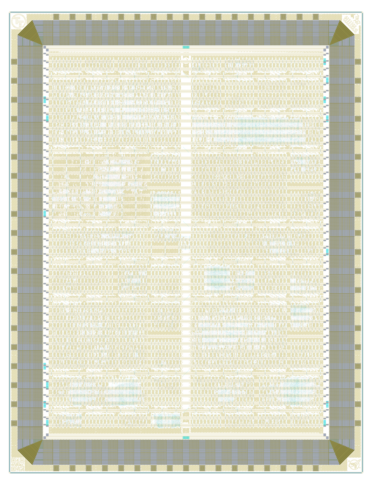

# Tiny Tapeout GF 0.2 on wafer.space Run 1

[Tiny Tapeout](https://tinytapeout.com/) chip [ttgf0p2](https://tinytapeout.com/chips/ttgf0p2), slot TTP2 of the [wafer.space GF180MCU Run 1](https://github.com/wafer-space/ws-run1) reticle (G801)

- Chip ID: ttgf0p2
- wafer.space run: ws-run1 (G801), slot TTP2
- Process: GF180MCU
- Number of projects: 52

<table width="100%">
  <tr>
  <td width="50%"></td>
  <td width="50%"></td>
  </tr>
</table>

This is one Tiny Tapeout die on a wafer.space shuttle; each project slot is a Tiny Tapeout project. See [PROVENANCE.md](PROVENANCE.md) for where the layout and project information come from.

# Projects

| Code | Project | Tiles | Author | Project Details | Repository |
|---|---|---|---|---|---|
| 000 | [Chip ROM](https://tinytapeout.com/chips/ttgf0p2/tt_um_chip_rom) | 1x1 | Uri Shaked | ROM with information about the chip | https://github.com/TinyTapeout/tt-chip-rom |
| 001 | [Tiny Tapeout Factory Test](https://tinytapeout.com/chips/ttgf0p2/tt_um_factory_test) | 1x1 | Tiny Tapeout | Factory test module | https://github.com/TinyTapeout/ttgf0p2-factory-test |
| 032 | [Zedulo TestChip1](https://tinytapeout.com/chips/ttgf0p2/tt_um_zedtc1_top) | 1x1 | Zedulo | Integration of UART and SPI IP's | https://github.com/ZeduloTech/ttgf-zed_tc1 |
| 033 | [Wafer.space Logo VGA Screensaver](https://tinytapeout.com/chips/ttgf0p2/tt_um_waferspace_vga_screensaver) | 1x2 | Uri Shaked | Wafer.space Logo bouncing around the screen (640x480, TinyVGA Pmod) | https://github.com/TinyTapeout/tt-waferspace-vga-screensaver |
| 038 | [Wildcat RISC-V](https://tinytapeout.com/chips/ttgf0p2/tt_um_schoeberl_wildcat) | 3x2 | Martin Schoeberl | Wildcat: a 3-stage RISC-V implementation | https://github.com/schoeberl/ttgf-wildcat |
| 039 | [TinyQV Risc-V SoC](https://tinytapeout.com/chips/ttgf0p2/tt_um_MichaelBell_tinyQV) | 3x4 | Michael Bell | A Risc-V SoC for Tiny Tapeout | https://github.com/MichaelBell/ttgf0p2-tinyQV |
| 101 | [SCµM-BLE-RX](https://tinytapeout.com/chips/ttgf0p2/tt_um_BLE_RX) | 3x4 | Dingyu Zhou | Digital Baseband for SCµM3 BLE | https://github.com/ZDYnb/ttgf-BLE_Receiver |
| 102 | [Silly-Faust](https://tinytapeout.com/chips/ttgf0p2/tt_um_gf0p2_faust_top) | 4x2 | Louis Ledoux, Cochard Pierre | Trial to use the audio circuit compiler for open silicon | https://github.com/Bynaryman/ttgf0p2-faust-mlir-silicon |
| 103 | [Simon's Caterpillar](https://tinytapeout.com/chips/ttgf0p2/tt_um_htfab_caterpillar) | 1x2 | htfab | Port of Caterpillar Logic to Simon Says PMOD | https://github.com/htfab/ttgf0p2-caterpillar |
| 128 | [VGA clock](https://tinytapeout.com/chips/ttgf0p2/tt_um_vga_clock) | 1x1 | Matt Venn | Shows the time on a VGA screen | https://github.com/mattvenn/GF180-VGA-clock-waferspace |
| 129 | [2x2 MAC Systolic array with DFT](https://tinytapeout.com/chips/ttgf0p2/tt_um_essen) | 1x2 | Julia Desmazes | 2x2 multiply and accumulate systolic array supporting signed 8 bit values with design for test infrastructure. | https://github.com/Essenceia/Systolic_MAC_with_DFT |
| 130 | [USB CDC (Serial) Device](https://tinytapeout.com/chips/ttgf0p2/tt_um_urish_usb_cdc) | 1x2 | Uri Shaked | USB to UART bridge, 115200 baud rate | https://github.com/urish/tt-usbcdc-device |
| 134 | [VGA Drop (audio/visual demo)](https://tinytapeout.com/chips/ttgf0p2/tt_um_rejunity_vga_test01) | 2x2 | ReJ aka Renaldas Zioma, eriQue aka Erik Hemming, Matthias Kampa | Tiny 8 part Megademo! TBL^Nesnausk^SonikClique | https://github.com/rejunity/tt08-vga-drop |
| 135 | [raybox-zero TTGF0p2 edition](https://tinytapeout.com/chips/ttgf0p2/tt_um_algofoogle_raybox_zero) | 3x4 | algofoogle (Anton Maurovic) | TTGF0p2 v1.8-dev submission of 'simple VGA ray caster game demo' from TT07/TTCAD25a | https://github.com/algofoogle/ttgf0p2-raybox-zero |
| 194 | [2048 sliding tile puzzle game (VGA)](https://tinytapeout.com/chips/ttgf0p2/tt_um_2048_vga_game) | 2x2 | Uri Shaked | Slide numbered tiles on a grid to combine them to create a tile with the number 2048. | https://github.com/urish/tt-2048-game |
| 196 | [Quickscope](https://tinytapeout.com/chips/ttgf0p2/tt_um_thezoq2_quickscope) | 1x2 | Frans Skarman | A quick logic analyzer | https://github.com/TheZoq2/tt-um-thezoq2-quickscope |
| 197 | [LISA 8-Bit Microcontroller](https://tinytapeout.com/chips/ttgf0p2/tt_um_lisa) | 3x4 | Ken Pettit | 8-Bit Microcontroller SOC with 128 bytes DFFRAM module | https://github.com/kdp1965/ttgf-um-lisa |
| 198 | [easy PAL](https://tinytapeout.com/chips/ttgf0p2/tt_um_MATTHIAS_M_PAL_TOP_WRAPPER) | 1x2 | Ken Pettit | This is a simple PAL (by Matthias Musch) using shift-register based configuration | https://github.com/kdp1965/ttgf-um-easy-PAL |
| 199 | [VGA Nyan Cat](https://tinytapeout.com/chips/ttgf0p2/tt_um_a1k0n_nyancat) | 1x2 | Andy Sloane | Displays the classic nyan.cat animation | https://github.com/a1k0n/ttgf0p2-a1k0n-nyan |
| 288 | [Notre Dame - Lockpick Game TT Example](https://tinytapeout.com/chips/ttgf0p2/tt_um_mmorri22_lockpick_game) | 1x2 | Matthew Morrison | An example SystemVerilog Implementation of a pipelined input/output for future TinyTapeout use in the classroom | https://github.com/mmorri22/lockpick |
| 295 | [KianV uLinux SoC](https://tinytapeout.com/chips/ttgf0p2/tt_um_kianV_rv32ima_uLinux_SoC) | 4x4 | Hirosh Dabui | A RISC-V ASIC that can boot μLinux. | https://github.com/TinyTapeout/KianV-RV32IMA-RISC-V-uLinux-SoC |
| 358 | [Notre Dame - CSE 30342 - DIC - Advanced FSM Final Project Example](https://tinytapeout.com/chips/ttgf0p2/tt_um_mmorri22_cse_30342) | 1x2 | Matthew Morrison | Example of SystemVerilog code with FSM and IO pipelining. | https://github.com/mmorri22/tt_um_mmorri22_cse_30342 |
| 359 | [Simple RISC-V](https://tinytapeout.com/chips/ttgf0p2/tt_um_simple_riscv) | 4x2 | kinako71-2 | Simple RISC-V based on the university lecture | https://github.com/urish/TTGF0p2 |
| 384 | [LEDs Racer](https://tinytapeout.com/chips/ttgf0p2/tt_um_kercrafter_leds_racer) | 1x2 | KerCrafter | Funny electronic game with WS2812B LEDs | https://github.com/KerCrafter/FPGA-LEDs-Racer |
| 385 | [Frequency Counter SSD1306 OLED](https://tinytapeout.com/chips/ttgf0p2/tt_um_frequency_counter) | 1x2 | Pawel Sitarz (embelon) | Simple Frequency Counter displaying result on SSD1306 SPI OLED | https://github.com/embelon/ttgf-frequency-counter-oled |
| 391 | [megabytebeat](https://tinytapeout.com/chips/ttgf0p2/tt_um_proppy_megabytebeat) | 3x2 | proppy | Best-of compilation of bytebeat 2011's greatest hits on-a-chip. | https://github.com/proppy/ttgf-bytebeat |
| 451 | [Asicle v2](https://tinytapeout.com/chips/ttgf0p2/tt_um_htfab_asicle2) | 2x2 | htfab | Wordle clone in raw silicon | https://github.com/htfab/ttgf0p2-asicle2 |
| 454 | [CAN Controller for Rocket](https://tinytapeout.com/chips/ttgf0p2/tt_um_noritsuna_CAN_CTRL) | 1x2 | Noritsuna Imamura | CAN Controller for Rocket | https://github.com/noritsuna/ttgf0p2-tt_um_noritsuna_CAN_CTRL |
| 455 | [Zilog Z80](https://tinytapeout.com/chips/ttgf0p2/tt_um_rejunity_z80) | 2x2 | ReJ aka Renaldas Zioma | Z80 open-source silicon. Goal is to become a silicon proven, pin compatible, open-source replacement for classic Z80. | https://github.com/rejunity/z80-open-silicon |
| 481 | [ROTFPGA v2](https://tinytapeout.com/chips/ttgf0p2/tt_um_htfab_rotfpga2) | 1x2 | htfab | A reconfigurable logic circuit made of identical rotatable tiles | https://github.com/htfab/ttgf0p2-rotfpga |
| 483 | [7-Segment Digital Desk Clock](https://tinytapeout.com/chips/ttgf0p2/tt_um_digital_clock_example) | 1x1 | Samuel Ellicott | 7-Segment Desk Clock | https://github.com/sellicott/digital_clock_gf0p2 |
| 485 | [MarcoPolo](https://tinytapeout.com/chips/ttgf0p2/tt_um_javibajocero_top) | 1x1 | Javier Munoz Saez | when this UART receives 'MARCO' answers ' POLO! ' , adapted from https://github.com/javiBajoCero/ttihp-verilog-template | https://github.com/javiBajoCero/ttgf-verilog-template |
| 487 | [Linear Timecode (LTC) generator](https://tinytapeout.com/chips/ttgf0p2/tt_um_flummer_ltc) | 1x1 | Thomas Flummer | Timecode generator for audio video syncronization | https://github.com/flummer/tt-um-flummer-ltc |
| 513 | [Classic 8-bit era Programmable Sound Generator SN76489](https://tinytapeout.com/chips/ttgf0p2/tt_um_rejunity_sn76489) | 1x1 | ReJ aka Renaldas Zioma | The SN76489 Digital Complex Sound Generator (DCSG) is a programmable sound generator chip from Texas Instruments. | https://github.com/rejunity/tt05-psg-sn76489 |
| 515 | [VGA Tiny Logo](https://tinytapeout.com/chips/ttgf0p2/tt_um_rejunity_vga_logo) | 1x1 | Renaldas Zioma | Large 480x480 pixels Tiny Tapeout logo with bling and dithered colors crammed into 1 tile! | https://github.com/rejunity/ttgf-vga-tiny-tapeout-animated-logo |
| 517 | [Ring Oscillator (5 inverter)](https://tinytapeout.com/chips/ttgf0p2/tt_um_dlmiles_ringosc_5inv) | 1x1 | Darryl Miles | Ring Oscillator (5 inverter) | https://github.com/dlmiles/ttgf0p2-ringosc-5inv |
| 519 | [Simon Says memory game](https://tinytapeout.com/chips/ttgf0p2/tt_um_urish_simon) | 1x1 | Uri Shaked | Repeat the sequence of colors and sounds to win the game | https://github.com/urish/tt-simon-game |
| 545 | [Flame demo](https://tinytapeout.com/chips/ttgf0p2/tt_um_kbeckmann_flame) | 1x1 | Konrad Beckmann & Linus Mårtensson | Flame demo | https://github.com/kbeckmann/ttgf0p2-kbeckmann-flame |
| 547 | [WokwiPWM](https://tinytapeout.com/chips/ttgf0p2/tt_um_wokwi_445338187869298689) | 1x1 | Ken Pettit | A 4-channel PWM impelemented in PWM gates | https://github.com/kdp1965/ttgf-um-wokwi-pwm |
| 549 | [Dog Battle Game](https://tinytapeout.com/chips/ttgf0p2/tt_um_SophusAndreassen_dogbattle) | 1x1 | Sophus Andreassen | A simple VGA dog battle game with 2 moving boxes that collide. | https://github.com/jorgenkraghjakobsen/tt_gf_dog_fight |
| 551 | [PVTMonitorSuite](https://tinytapeout.com/chips/ttgf0p2/tt_um_zacky1972_PVTMonitorSuite) | 1x1 | Susumu Yamazaki | PVTMonitorSuite: A fully digital, modular suite for measuring gate delays, flip-flop timings, and clock skew under varying process, voltage, and temperature conditions. | https://github.com/zacky1972/ttgf0p2-PVTMonitorSuite |
| 577 | [PILIPINAS_IC](https://tinytapeout.com/chips/ttgf0p2/tt_um_wokwi_392873974467527681) | 1x1 | Alexander Co Abad and Dino Dominic Ligutan | 7-seg Display for PILIPINASLASALLE | https://github.com/alexandercoabad/PILIPINAS_IC |
| 579 | [PRISM 8 with TinySnake](https://tinytapeout.com/chips/ttgf0p2/tt_um_wokwi_442081253563458561) | 1x1 | Ken Pettit | PRISM plus Tiny Snake implemented in Wowki | https://github.com/kdp1965/ttgf-um-pettit-prism |
| 581 | [Register bank accessible through SPI and I2C](https://tinytapeout.com/chips/ttgf0p2/tt_um_calonso88_spi_i2c_reg_bank) | 1x1 | Caio Alonso da Costa | Register bank accessible through SPI and I2C | https://github.com/calonso88/tt_spi_i2c_reg_bank |
| 583 | [Cell mux](https://tinytapeout.com/chips/ttgf0p2/tt_um_htfab_cells) | 1x1 | htfab | All the gf180mcu 7-track standard cells | https://github.com/htfab/ttgf0p2-cells |
| 609 | [Super-Simple-SPI-CPU](https://tinytapeout.com/chips/ttgf0p2/tt_um_spi_cpu_top) | 1x1 | James Ashie Kotey | A 4-bit CPU using the SPI Flash RAM from the QSPI PMOD to load programs. | https://github.com/Sheffield-Chip-Design-Team/SPI-CPU-Final |
| 610 | [Example of Bad Synchronizer](https://tinytapeout.com/chips/ttgf0p2/tt_um_dlmiles_bad_synchronizer) | 1x1 | Darryl Miles project from Eric Smith | Figure 29.3 from Dally & Harting | https://github.com/dlmiles/ttgf25a-bad-synchronizer |
| 611 | [Video mode tester](https://tinytapeout.com/chips/ttgf0p2/tt_um_htfab_vga_tester) | 1x1 | htfab | Experiment with different VGA timing parameters | https://github.com/htfab/ttgf0p2-vga-tester |
| 612 | [One Bit PUF](https://tinytapeout.com/chips/ttgf0p2/tt_um_multi_bit_puf_wrapper) | 1x1 | Yimin Gao and Ceylan Morgul | It is a PUF based on a difference of two registers | https://github.com/Capulus123/ttihp03-multi-bit-puf |
| 613 | [DDR throughput and flop aperature test](https://tinytapeout.com/chips/ttgf0p2/tt_um_dlmiles_ddr_throughput_test) | 1x1 | Darryl Miles project from Eric Smith | Grab data on every edge of clock with varying pos pulse width | https://github.com/dlmiles/ttgf25a-ddr-throughput-test |
| 614 | [Ring osc on VGA](https://tinytapeout.com/chips/ttgf0p2/tt_um_algofoogle_vgaringosc) | 1x1 | algofoogle (Anton Maurovic) | VGA display visualisation of a ring oscillator doing work | https://github.com/algofoogle/ttgf0p2-vga-ring-osc |
| 615 | [GF180MCU loopback tile with input skew measurement](https://tinytapeout.com/chips/ttgf0p2/tt_um_dlmiles_loopback) | 1x1 | Darryl Miles project from Eric Smith | Count up to 10, one second at a time. | https://github.com/dlmiles/ttgf25a-loopback-with-skew |

The code is the project's Tiny Tapeout multiplexer address.

# View the Layout

1. To view the layout, please install [KLayout](https://www.klayout.de/).
2. Next, assemble `TTP2.oas` from the individual files: `cd layout; cat TTP2-part-?? >TTP2.oas`
3. The assembled `TTP2.oas` file can then be opened with KLayout.
4. Finally, load the layer properties file in KLayout: "File → Load Layer Properties" and choose `lyp/gf180mcu.lyp` at the top of this repository.

Note: The `TTP2.oas` file was split with `split -b 90M TTP2.oas TTP2-part-`

# License

The projects shown here are public. For information on licences, please refer to the individual repositories.
