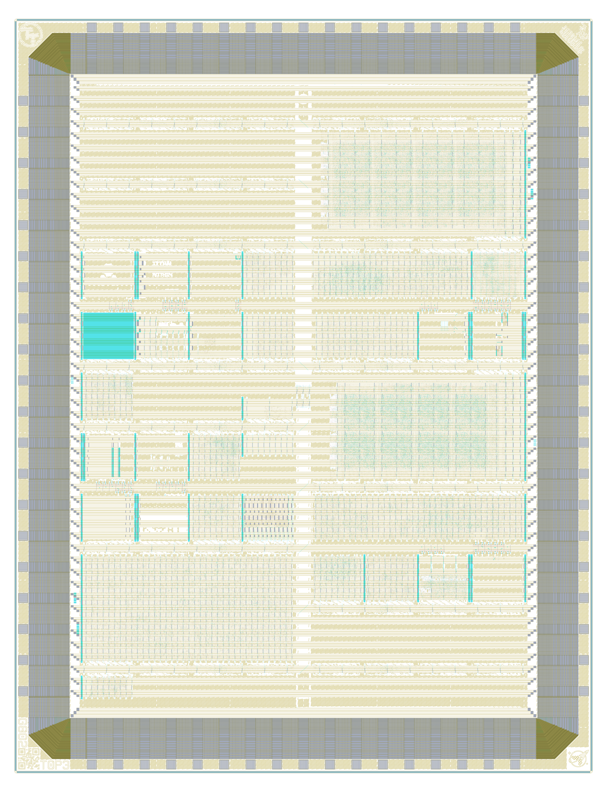

# Tiny Tapeout GF 0p3 on wafer.space Run 2

[Tiny Tapeout](https://tinytapeout.com/) chip [ttgf0p3](https://tinytapeout.com/chips/ttgf0p3), slot T0P3 of the [wafer.space GF180MCU Run 2](https://github.com/wafer-space/ws-run2) reticle (G802)

- Chip ID: ttgf0p3
- wafer.space run: ws-run2 (G802), slot T0P3
- Process: GF180MCU
- Number of projects: 32

<table width="100%">
  <tr>
  <td width="50%"></td>
  <td width="50%"></td>
  </tr>
</table>

This is one Tiny Tapeout die on a wafer.space shuttle; each project slot is a Tiny Tapeout project. See [PROVENANCE.md](PROVENANCE.md) for where the layout and project information come from.

# Projects

| Code | Project | Tiles | Author | Project Details | Repository |
|---|---|---|---|---|---|
| 000 | [Chip ROM](https://tinytapeout.com/chips/ttgf0p3/tt_um_chip_rom) | 1x1 | Uri Shaked | ROM with information about the chip | https://github.com/TinyTapeout/tt-chip-rom |
| 001 | [Tiny Tapeout Factory Test](https://tinytapeout.com/chips/ttgf0p3/tt_um_factory_test) | 1x1 | Tiny Tapeout | Factory test module | https://github.com/TinyTapeout/ttgf26a-factory-test |
| 003 | [VGA Nyan Cat](https://tinytapeout.com/chips/ttgf0p3/tt_um_a1k0n_nyancat) | 1x2 | Andy Sloane | Displays the classic nyan.cat animation | https://github.com/urish/ttgf0p2-a1k0n-nyan |
| 005 | [74HCT00 Quad 2-Input NAND (3.3 V)](https://tinytapeout.com/chips/ttgf0p3/tt_um_74hct00) | 1x2 | Vipul Sharma | Open-source silicon realization of 74HCT00 TTL-compatible quad 2-input NAND on gf180mcuD at 3.3 V | https://github.com/engrvip123/tt_um_74hct00 |
| 007 | [TT GF180mcuD Analog Factory Test](https://tinytapeout.com/chips/ttgf0p3/tt_um_analog_factory_test) | 1x2 | Sylvain Munaut | Test structures for GF180mcuD analog support | https://github.com/smunaut/ttgf_analog_factory_test |
| 033 | [Simple Signal Generator](https://tinytapeout.com/chips/ttgf0p3/tt_um_mattvenn_signal_generator) | 1x2 | Matt Venn | Square wave generator with a phase-shifting second channel for metastability experiments | https://github.com/mattvenn/simple-signal-generator |
| 035 | [GF R2R DAC](https://tinytapeout.com/chips/ttgf0p3/tt_um_gf_r2r_dac) | 1x2 | Matt Venn | 8 bit R2R DAC | https://github.com/mattvenn/gf-r2r-dac |
| 037 | [algofoogle analog stuff](https://tinytapeout.com/chips/ttgf0p3/tt_um_algofoogle_gf_analog) | 1x2 | algofoogle (Anton Maurovic) | Some analog and custom layout experiments in gf180mcuD for ttgf0p3 (the TT GF 1st analog experimental shuttle) | https://github.com/algofoogle/ttgf0p3-algofoogle-analog |
| 038 | [Hardware Entropy Explorer: UART/SPI TRNG and PUF](https://tinytapeout.com/chips/ttgf0p3/tt_um_gojimmypi_ttgfa_UART_FSM_TRNG_Lab) | 1x2 | gojimmypi | UART/SPI-controlled ASIC lab for exploring true-random number generation and PUF-style hardware entropy sources. | https://github.com/gojimmypi/ttgf0p3-UART-FSM-TRNG-Lab |
| 039 | [MoM capacitor](https://tinytapeout.com/chips/ttgf0p3/tt_um_htfab_momcap) | 1x2 | htfab | Simple metal-oxide-metal capacitor for gf180mcuD that fills an analog 1x2 tile | https://github.com/htfab/ttgf0p3-momcap |
| 099 | [Until heat death do us part](https://tinytapeout.com/chips/ttgf0p3/tt_um_coldbrew) | 2x2 | Julia Desmazes | Counting until the heat death of the universe, broadcasting counter value every second over ethernet. | https://github.com/Essenceia/Until_Heat_Death_Do_Us_Part |
| 101 | [TT GF180mcuD Testbuffer](https://tinytapeout.com/chips/ttgf0p3/tt_um_cw_testbuffer) | 1x2 | Christoph Weiser | Analog voltage buffer | https://github.com/christoph-weiser/ttgf0p3-submission |
| 102 | [Tiny FABulous FPGA](https://tinytapeout.com/chips/ttgf0p3/tt_um_fabulous_gf_0p3) | 4x4 | Leo Moser | A tiny FABulous FPGA fabric, ready for use with Yosys and nextpnr. | https://github.com/mole99/tt-fabulous-gf-0p3 |
| 103 | [tnt's recreation of a 555 on GF180mcu](https://tinytapeout.com/chips/ttgf0p3/tt_um_tnt_gf_555) | 1x2 | Sylvain Munaut | Just a simple classic timer IC re-imagined | https://github.com/smunaut/tt_tnt_gf_555 |
| 199 | [TinyQV Risc-V SoC](https://tinytapeout.com/chips/ttgf0p3/tt_um_MichaelBell_tinyQV) | 4x2 | Michael Bell | A Risc-V SoC for Tiny Tapeout | https://github.com/MichaelBell/ttgf0p3-tinyQV |
| 256 | [256x8 SRAM](https://tinytapeout.com/chips/ttgf0p3/tt_um_essen) | 1x2 | Julia Desmazes | 256x8 SRAM for testing | https://github.com/Essenceia/tt_gf_ocd_sram_test |
| 258 | [Abad2048](https://tinytapeout.com/chips/ttgf0p3/tt_um_AbAdA_2048) | 1x2 | Alexander Co Abad | Colorful 2048 game uploaded successfully to the TT FPGA with game pmod! | https://github.com/alexandercoabad/Abad_2048 |
| 260 | [GF BGR](https://tinytapeout.com/chips/ttgf0p3/tt_um_rahulbhagwat_gf180_bandgap_reference) | 1x2 | Rahul Bhagwat | Bandgap Reference | https://github.com/bhagwat-rahul/ttgf180-bandgap-reference |
| 262 | [Quadrature VCO](https://tinytapeout.com/chips/ttgf0p3/tt_um_tnt_gf_vco) | 1x2 | Sylvain Munaut | Quadrature VCO with nominal target frequency of 240 MHz | https://github.com/smunaut/tt_tnt_gf_vco |
| 288 | [Philippine flag waving](https://tinytapeout.com/chips/ttgf0p3/tt_um_combined) | 1x2 | Alexander Co Abad | Philippine flag waving in a DVD-like screensaver with PILIPINAS text in a 7-segment style at the bottom | https://github.com/alexandercoabad/PILIPINAS_waving |
| 290 | [Analog 4 bit Current DAC](https://tinytapeout.com/chips/ttgf0p3/tt_um_kiterai_current_dac) | 1x2 | Kiterai | Simple 4 bit current output DAC | https://github.com/Kiterai/ttgf-practice1 |
| 292 | [3.3V Folded Cascode OTA](https://tinytapeout.com/chips/ttgf0p3/tt_um_LPCAS_TTGF0P3_TP1) | 1x2 | Pranay Arvind Patil and Nithin Purushothama | NMOS Input pair based Folded Cascode OTA | https://github.com/chennakeshavadasa/LPCAS_TTGF0P3_TP1 |
| 294 | [Oscillating Bones](https://tinytapeout.com/chips/ttgf0p3/tt_um_oscillating_bones) | 1x2 | Uri Shaked | A stylish SkullFET ring oscillator (~120 MHz) with an 8-bit /2../256 divider | https://github.com/urish/ttgf-oscillating-bones |
| 356 | [2048 sliding tile puzzle game (VGA)](https://tinytapeout.com/chips/ttgf0p3/tt_um_2048_vga_game) | 3x2 | Uri Shaked | Slide numbered tiles on a grid to combine them to create a tile with the number 2048. | https://github.com/urish/tt-2048-game |
| 358 | [Hardware Entropy Explorer: UART/SPI TRNG and PUF (Analog)](https://tinytapeout.com/chips/ttgf0p3/tt_um_gojimmypi_ttgfa_UART_FSM_TRNG_Lab_analog) | 1x2 | gojimmypi | UART/SPI-controlled GF180 analog lab with DAC, threshold sampling, TRNG monitors, and measured ua5 passive probe. | https://github.com/gojimmypi/ttgf0p3-analog-UART-FSM-TRNG-Lab |
| 359 | [Tiny FABulous FPGA (3.3V version)](https://tinytapeout.com/chips/ttgf0p3/tt_um_fabulous_gf_0p3_3v3) | 4x4 | Leo Moser | A tiny FABulous FPGA fabric, ready for use with Yosys and nextpnr. | https://github.com/mole99/tt-fabulous-gf-0p3-3v3 |
| 448 | [Wafer.space Logo VGA Screensaver](https://tinytapeout.com/chips/ttgf0p3/tt_um_waferspace_vga_screensaver) | 1x2 | Uri Shaked | Wafer.space Logo bouncing around the screen (640x480, TinyVGA Pmod) | https://github.com/TinyTapeout/tt-waferspace-vga-screensaver |
| 450 | [USB CDC (Serial) Device](https://tinytapeout.com/chips/ttgf0p3/tt_um_urish_usb_cdc) | 1x2 | Uri Shaked | USB to UART bridge, 115200 baud rate | https://github.com/urish/tt-usbcdc-device |
| 452 | [PolyWave](https://tinytapeout.com/chips/ttgf0p3/tt_um_odgrip_polywave) | 1x2 | Riccardo Pellegrini | Mixed-signal four-channel waveform source with a compact digital engine driving four 16-bit R-2R DACs. | https://github.com/ODGrip/ttgf-polywave |
| 454 | [MCML VCO](https://tinytapeout.com/chips/ttgf0p3/tt_um_mcml_vco) | 1x2 | Namibj | An MCML VCO | https://github.com/namibj/tt_gf-0p3_mcml |
| 518 | [KianV uLinux SoC](https://tinytapeout.com/chips/ttgf0p3/tt_um_kianV_rv32ima_uLinux_SoC) | 4x4 | Hirosh Dabui | A RISC-V ASIC that can boot μLinux. | https://github.com/TinyTapeout/KianV-RV32IMA-RISC-V-uLinux-SoC |
| 519 | [Simon Says memory game](https://tinytapeout.com/chips/ttgf0p3/tt_um_urish_simon) | 1x1 | Uri Shaked | Repeat the sequence of colors and sounds to win the game | https://github.com/urish/tt-simon-game |

The code is the project's Tiny Tapeout multiplexer address.

# View the Layout

1. To view the layout, please install [KLayout](https://www.klayout.de/).
2. Next, assemble `T0P3.oas` from the individual files: `cd layout; cat T0P3-part-?? >T0P3.oas`
3. The assembled `T0P3.oas` file can then be opened with KLayout.
4. Finally, load the layer properties file in KLayout: "File → Load Layer Properties" and choose `lyp/gf180mcu.lyp` at the top of this repository.

Note: The `T0P3.oas` file was split with `split -b 90M T0P3.oas T0P3-part-`

# License

The projects shown here are public. For information on licences, please refer to the individual repositories.
