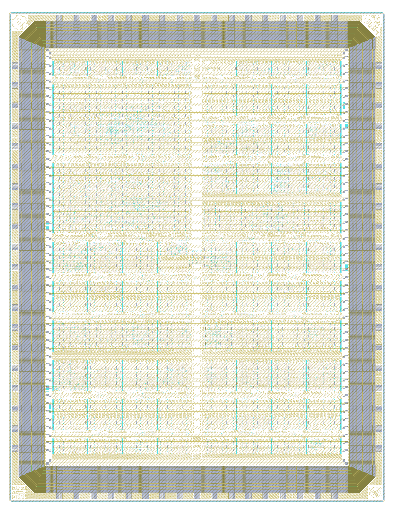

# Tiny Tapeout GF 26a on wafer.space Run 2

[Tiny Tapeout](https://tinytapeout.com/) chip [ttgf26a](https://tinytapeout.com/chips/ttgf26a), slot T26A of the [wafer.space GF180MCU Run 2](https://github.com/wafer-space/ws-run2) reticle (G802)

- Chip ID: ttgf26a
- wafer.space run: ws-run2 (G802), slot T26A
- Process: GF180MCU
- Number of projects: 95

<table width="100%">
  <tr>
  <td width="50%"></td>
  <td width="50%"></td>
  </tr>
</table>

This is one Tiny Tapeout die on a wafer.space shuttle; each project slot is a Tiny Tapeout project. See [PROVENANCE.md](PROVENANCE.md) for where the layout and project information come from.

# Projects

| Code | Project | Tiles | Author | Project Details | Repository |
|---|---|---|---|---|---|
| 000 | [Chip ROM](https://tinytapeout.com/chips/ttgf26a/tt_um_chip_rom) | 1x1 | Uri Shaked | ROM with information about the chip | https://github.com/TinyTapeout/tt-chip-rom |
| 001 | [Tiny Tapeout Factory Test](https://tinytapeout.com/chips/ttgf26a/tt_um_factory_test) | 1x1 | Tiny Tapeout | Factory test module | https://github.com/TinyTapeout/ttgf26a-factory-test |
| 003 | [Counter16Outputs](https://tinytapeout.com/chips/ttgf26a/tt_um_AlvaroRub_ringcounter) | 1x1 | Alvaro Rubio | A 16-bit ring counter that sequentially activates its outputs at the clock rate. | https://github.com/AlvaroRub/tt-alvaros-first-wokwi |
| 005 | [2x2 CNN Accelerator PE Grid with UART](https://tinytapeout.com/chips/ttgf26a/tt_um_peg_top) | 1x1 | Vidhyanandhan Sathishkumar | UART-controlled 2x2 systolic processing-element grid for CNN inference. Send 3-byte packets over UART to drive activations/weights; receive 2-byte psum results. | https://github.com/Vidhyanandhan-01/tinytapeout-gf |
| 007 | [2x2 Systolic Array Matrix Multiplier](https://tinytapeout.com/chips/ttgf26a/tt_um_systolic_mac_2x2) | 1x1 | Irene-ux | 2x2 output-stationary systolic array for signed 4-bit matrix multiply on GF180 | https://github.com/Irene-ux/tt-systolic-array-2x2 |
| 032 | [Hardware UTF Encoder/Decoder](https://tinytapeout.com/chips/ttgf26a/tt_um_rebeccargb_hardware_utf8) | 1x1 | Rebecca G. Bettencourt | Converts Unicode code points between UTF-8, UTF-16, and UTF-32. | https://github.com/RebeccaRGB/ttgf-hardware-utf8 |
| 034 | [2x2 MAC Systolic array with DFT](https://tinytapeout.com/chips/ttgf26a/tt_um_systolic_array) | 1x2 | Vijay Sharma | 2x2 multiply and accumulate systolic array supporting signed 8 bit values with design for test infrastructure. | https://github.com/Eulerianial/tt_gf_systolic_array |
| 036 | [FSK Modem](https://tinytapeout.com/chips/ttgf26a/tt_um_hydrocomms) | 1x2 | Vaishnavi V | FSK modem for underwater acoustic communication (46-56 kHz, 100 bps) | https://github.com/vvedn/hydrocomms-tt |
| 038 | [RRAM Characterization Platform (DC sweep + endurance + retention + histogram, GF180)](https://tinytapeout.com/chips/ttgf26a/tt_um_santhosh_rsd_char_gf) | 1x2 | Prof. Santhosh Sivasubramani, IIT Delhi | GF180mcuD standalone characterization platform for one external resistive-switching device (RRAM / memristor / PCM). Drives an 8-bit DAC rail and reads back an 8-bit ADC rail, with four SPI-selectable modes: DC sweep (VSTART..VSTOP by VSTEP with on-chip 16-bin histogram and min/max tracking), pulse endurance (N cycles of SET/read-verify/RESET/read-verify with THR_LO / THR_HI checks, latches FAIL_IDX on first miss), retention (SET pulse then periodic reads at programmable interval), and free-running histogram capture. 25 MHz signoff clock. | https://github.com/SanthoshSivasubramani/tt_um_santhosh_rsd_char_gf_pub |
| 039 | [Programmable_Pipeline-RISC-V](https://tinytapeout.com/chips/ttgf26a/tt_um_prem_pipeline_test) | 4x4 | Prem | Zero to ASIC demo project | https://github.com/PrmBRana/ttgf_prem_programmable_RISC_v |
| 065 | [Antonio's first Wokwi design](https://tinytapeout.com/chips/ttgf26a/tt_um_wokwi_465731440267947009) | 1x1 | Antonio | An elite project | https://github.com/aglcoin04/tt-antonios-first-wokwi |
| 066 | [sdft wokwi 1](https://tinytapeout.com/chips/ttgf26a/tt_um_wokwi_465731403724006401) | 1x1 | Santiago Díaz Fernández de la Torre | some bs | https://github.com/santidft/tt-sdft-wokwi-1 |
| 067 | [Guille's first Wokwi design.](https://tinytapeout.com/chips/ttgf26a/tt_um_wokwi_465732706576877569) | 1x1 | Guillermo | Proyecto elite. | https://github.com/guillermomillansolis-rgb/tt-guilles-first-wokwi |
| 068 | [Line Follower Robot controller](https://tinytapeout.com/chips/ttgf26a/tt_um_line_follower_arvaloez) | 1x1 | Escuela Colombiana de Ingenieria Julio Gravito | Basic controller for a line follower of 8 sensors | https://github.com/Arvaloez/ECI_SEGUIDOR_LINEA_IEEE_BOOTCAMP |
| 069 | [MIPS-Lite 8-bit Processor](https://tinytapeout.com/chips/ttgf26a/tt_um_wokwi_465731481873367041) | 1x1 | Jesus (jalperdev) | 8-bit MIPS-inspired single-cycle processor with 8 registers, ALU, branches and jumps | https://github.com/jalperdev/tt-chip-design-nucleo |
| 070 | [xoroshiro64](https://tinytapeout.com/chips/ttgf26a/tt_um_xoroshiro64plus_v2) | 1x1 | Vivek Chiranjit | xoroshiro TRNG | https://github.com/ChiranjitPatel/ttgf_xoroshiro64 |
| 071 | [Juan`s first Worki design](https://tinytapeout.com/chips/ttgf26a/tt_um_wokwi_465736612213902337) | 1x1 | Juan Andres | Proyecto bombi de la elite, drip drip | https://github.com/JuanAndres6386/tt-juans-first-worki |
| 096 | [Wafer.space Logo VGA Screensaver](https://tinytapeout.com/chips/ttgf26a/tt_um_waferspace_vga_screensaver) | 1x2 | Uri Shaked | Wafer.space Logo bouncing around the screen (640x480, TinyVGA Pmod) | https://github.com/TinyTapeout/tt-waferspace-vga-screensaver |
| 098 | [happyhop](https://tinytapeout.com/chips/ttgf26a/tt_um_happyhop_deadcast2) | 1x1 | deadcast2 | A bouncing smiley face rendered live to VGA via the standard TT VGA PMOD. No framebuffer; pixels computed on the fly. | https://github.com/deadcast2/tt_um_happyhop |
| 100 | [Dino-7: 7-Segment Runner Game](https://tinytapeout.com/chips/ttgf26a/tt_um_dino7) | 1x1 | Dr Sopes | A minimalist single-button endless runner game inspired by the Chrome Dinosaur game, rendered on a single 7-segment display. Features an LFSR of 32 bits, Hardware Difficulty Selector, and a High Score memory. | https://github.com/DrSopes/Dino-7-GF |
| 102 | [Custom DVD Screensaver for VGA](https://tinytapeout.com/chips/ttgf26a/tt_um_uacj) | 1x1 | Jazmin Nayeli / Kensy Buatista | Bouncing DVD logo on VGA with color change on wall hits, speed control, invert, and flip options | https://github.com/nayelikensy930-lang/tt_um_uacj_ |
| 103 | [Minimal RV32E SoC with UART Loader](https://tinytapeout.com/chips/ttgf26a/tt_um_kluterirv_rv32e_core) | 4x2 | Kris / KLuterIRV | Minimal RV32E microcontroller with UART program loader, internal instruction memory, GPIO and configurable 7-segment output | https://github.com/KLuterIRV/INNOVA-IRV-ULP-RISCV |
| 128 | [Tiny Tapeout Template Copy](https://tinytapeout.com/chips/ttgf26a/tt_um_wokwi_465731521356457985) | 1x1 | Pablo Ruiz | 7-Segment | https://github.com/pabloruizlopez2001-cloud/tt-template-copy |
| 129 | [7-Segment Neural Predictor](https://tinytapeout.com/chips/ttgf26a/tt_um_machinelearning) | 1x2 | Abdul Hannan A. | A small neural network that predicts digits 0-9 from 7-segment display patterns. | https://github.com/Nontinium/ttgf-machine-learning |
| 130 | [El primer diseño](https://tinytapeout.com/chips/ttgf26a/tt_um_wokwi_465731520738845697) | 1x1 | Maria Saldaña | Mi primer diseño con Wokwi | https://github.com/02mariasv/tt-el-primer-diseo |
| 132 | [Mi copia del Tiny Tapeout](https://tinytapeout.com/chips/ttgf26a/tt_um_wokwi_465731458628527105) | 1x1 | Antonio | Test del Taller Tiny Tapeout | https://github.com/VallejoPretelA/tt-mi-copia-del |
| 134 | [test1](https://tinytapeout.com/chips/ttgf26a/tt_um_wokwi_465736691688630273) | 1x1 | Alberto | First contact with the application | https://github.com/aperezfer/tt-test1 |
| 135 | [serv_soc_wb](https://tinytapeout.com/chips/ttgf26a/tt_um_divadnauj_GB_serv_soc_wb) | 3x2 | Juan David Guerrero Balaguera | Custom SOC using the SERV processor under RV32e | https://github.com/divadnauj-GB/tt_um_divadnauj-GB_serv_soc_wb |
| 192 | [Gen1 Digital Companion Tile](https://tinytapeout.com/chips/ttgf26a/tt_um_gen1_digital_companion_tile) | 1x1 | Juan Fernandez | Symbolic pulse-update and write-verify companion tile for a future local memristive AI chip | https://github.com/JuanCarlosFdezMlg/tt-juan-carloss-first |
| 194 | [Tiny Tapeout Template Ayman](https://tinytapeout.com/chips/ttgf26a/tt_um_wokwi_465732827753495553) | 1x1 | Ayman Harraz | Tinytapeout | https://github.com/aymanhq96/tt-template-ayman |
| 195 | [Tiny Pixel Processor](https://tinytapeout.com/chips/ttgf26a/tt_um_pixel_processor) | 2x2 | Julian Schlager, Thomas Lindinger, Patrick Pollak, Sebastian Gmeiner, Simon Vogelhuber | A custom processor built for generating procedural graphics | https://github.com/vogelhubersimon/Tiny-Pixel-Processor |
| 196 | [Julian_Proyecto](https://tinytapeout.com/chips/ttgf26a/tt_um_wokwi_465731394728267777) | 1x1 | Julián | It shows my first letter of my name | https://github.com/jpachecorub/tt-julianproyecto |
| 198 | [Tiny Tapeout Template Copy](https://tinytapeout.com/chips/ttgf26a/tt_um_wokwi_465731458535202817) | 1x1 | Alicia | Test | https://github.com/AliciaRRs/tt-template-copy |
| 199 | [Very Low Resource Digital Implementation of Bioimpedance Analysis](https://tinytapeout.com/chips/ttgf26a/tt_um_bioimpedance) | 2x2 | Fabien | Digital bioimpedance demodulator with 8-stage I/Q cascade and UART output | https://github.com/fabien-soulier/tt-gf26A-bioimpedance |
| 295 | [UTOSS RISC-V core](https://tinytapeout.com/chips/ttgf26a/tt_um_utoss_riscv) | 4x4 | University of Toronto Open Source Students | RV32I core implementation | https://github.com/UTOSS/risc-v-ttgf |
| 352 | [Hardware Entropy Explorer: UART/SPI TRNG and PUF](https://tinytapeout.com/chips/ttgf26a/tt_um_gojimmypi_ttgf_UART_FSM_TRNG_Lab) | 1x2 | gojimmypi | UART/SPI-controlled ASIC lab for exploring true-random number generation and PUF-style hardware entropy sources. | https://github.com/gojimmypi/ttgf-UART-FSM-TRNG-Lab |
| 353 | [DOTTEE VGA demo (TTGF26a)](https://tinytapeout.com/chips/ttgf26a/tt_um_algofoogle_dottee) | 1x1 | algofoogle (Anton Maurovic) | DOTTEE: Pretty little 1-tile Tiny Tapeout ASIC demo (TTGF26a version) | https://github.com/algofoogle/dottee-demo |
| 354 | [8-bit RISC CPU](https://tinytapeout.com/chips/ttgf26a/tt_um_8bit_risc_cpu) | 1x2 | Jan Kozina | 8-bit RISC CPU with ALU, registers, data memory and external 16-bit instructions | https://github.com/hofi505/risc-v-tt26a |
| 355 | [Simon Says memory game](https://tinytapeout.com/chips/ttgf26a/tt_um_urish_simon) | 1x1 | Uri Shaked | Repeat the sequence of colors and sounds to win the game | https://github.com/urish/tt-simon-game |
| 356 | [RHD2164-MCU-SPI Bridge](https://tinytapeout.com/chips/ttgf26a/tt_um_top) | 1x2 | Manuel Monge | Various SPIs | https://github.com/manuel-monge/tt2606 |
| 357 | [First Tinytapeout](https://tinytapeout.com/chips/ttgf26a/tt_um_wokwi_465483277165299713) | 1x1 | Raúl | First deployment with TinyTapeOut | https://github.com/raullopez54/tt-first-tinytapeout |
| 358 | [Stochastic neuron + STDP controller (merged, GF180)](https://tinytapeout.com/chips/ttgf26a/tt_um_santhosh_stoch_stdp_pair_gf) | 1x2 | Prof. Santhosh Sivasubramani, IIT Delhi | GF180mcuD merged-pair cell: an 8-bit saturating LIF/stochastic neuron with an 8-entry sigmoid LUT, 8-bit Galois LFSR, programmable refractory, per-clock leak, host-triggered stimulus on ext_input rising edge, homeostatic theta adaptation over a 256-clock window (theta_live floats between theta_min and theta_max depending on spike count vs reg_target), and a 16-clock Bayesian confidence window emitting a 2-bit conf output. The second block is an STDP controller with 8-bit pre/post spike traces, per-clock exponential-shift decay (reg_tau_plus / reg_tau_minus), an anti-Hebbian polarity bit and optional reward-gated learning; on every LTP event (post spike with pre trace != 0) or LTD event (pre spike with post trace != 0) a 1-cycle weight_update pulse is emitted along with a learn_dir bit and a magnitude latch read over SPI. All registers are programmable via an 8-bit-data SPI mode-0 slave shared with the other TTGF26a tiles. 25 MHz signoff. | https://github.com/SanthoshSivasubramani/tt_um_santhosh_stoch_stdp_pair_gf_pub |
| 359 | [Tiny Tapeout testtest 111233](https://tinytapeout.com/chips/ttgf26a/tt_um_wokwi_467219410242853889) | 1x1 | Suresh Devanathan | Test project for segment display | https://github.com/idatarm/tt-testtest-111233 |
| 384 | [teenytpu](https://tinytapeout.com/chips/ttgf26a/tt_um_joannec34_teenytpu) | 1x2 | joannec34 | 2x2 INT8 systolic-array TPU with SPI memory interface | https://github.com/joannec34/teenytpu |
| 385 | [Tiny Tapeout Workshop JuanF](https://tinytapeout.com/chips/ttgf26a/tt_um_wokwi_465736492859711489) | 1x1 | Juan | TinyTapeOutWorkshop | https://github.com/jfm92/tt-workshop-juanf |
| 386 | [Pong in Verilog](https://tinytapeout.com/chips/ttgf26a/tt_um_main) | 1x2 | Jorobraun, TnTim1, ColdC5 | A simple Pong game with VGA-style output | https://github.com/ColdC5/TinyTapeoutGFPong |
| 387 | [Tiny Tapeout Template_1234](https://tinytapeout.com/chips/ttgf26a/tt_um_wokwi_465732744934845441) | 1x1 | Najlae | hello world project | https://github.com/neshla/tt-template1234 |
| 388 | [Tiny TPU Systolic Array](https://tinytapeout.com/chips/ttgf26a/tt_um_bgao43) | 1x2 | Yu Xia，Bohong Gao, Junjie Yan, Yufeng Wang, Jinyao Sun, Arthur Stanson | A small systolic-array-based matrix multiplication accelerator | https://github.com/bgao43-wq/tt-tiny-tpu-gf180 |
| 389 | [Arturo's first Wokwi design](https://tinytapeout.com/chips/ttgf26a/tt_um_wokwi_465731371445677057) | 1x1 | Artcraft | My first ever Wokwi design | https://github.com/Artcraftx107/tt-arturos-first-wokwi |
| 390 | [GPS_Accelerator](https://tinytapeout.com/chips/ttgf26a/tt_um_jpigdon_gps_accelerator_top) | 1x2 | jpigdon | GNSS Accelerator to demonstrate acquisition and tracking on Tiny Tapeout | https://github.com/jpigdon/ttgf_gnss_accelerator |
| 391 | [Pacos first design](https://tinytapeout.com/chips/ttgf26a/tt_um_wokwi_465549494272929793) | 1x1 | Paco | Just AND gate | https://github.com/flozgom/tt-pacos-first-design |
| 448 | [APA102 to WS2812 Translator](https://tinytapeout.com/chips/ttgf26a/tt_um_apa102_ws2812_squidgeefish) | 1x2 | Squidgeefish | Convert a 7-LED APA102 stream to a WS2812-compatible one | https://github.com/squidgeefish/TT09 |
| 449 | [Rafa’s first Wokwi design](https://tinytapeout.com/chips/ttgf26a/tt_um_wokwi_465731430225727489) | 1x1 | Rafael Morales | tipitaka chip | https://github.com/RafaMG10/tt-rafas-first-wokwi |
| 450 | [Simple MAC Engine w/ Postproc](https://tinytapeout.com/chips/ttgf26a/tt_um_arty3_mac_engine) | 1x2 | Luca Goddijn | Quantized INT8 MAC engine with bias, activation, and quantizer postproc, SPI-controlled | https://github.com/Arty3/ttgf-mac-engine |
| 451 | [7 segment Display Fli-Flop Try-out](https://tinytapeout.com/chips/ttgf26a/tt_um_wokwi_465731458365332481) | 1x1 | Carlos David | An amazing flip-flop example with a seven segment display | https://github.com/CarlosDavidTorresRico/tt-7-segment-display |
| 452 | [Simple Signal Generator](https://tinytapeout.com/chips/ttgf26a/tt_um_mattvenn_signal_generator) | 1x2 | Matt Venn | Square wave generator with a phase-shifting second channel for metastability experiments | https://github.com/mattvenn/simple-signal-generator |
| 453 | [DiseñoCursoTiny](https://tinytapeout.com/chips/ttgf26a/tt_um_wokwi_465732744245929985) | 1x1 | José Ramñirez Díaz | biestables | https://github.com/joserdElectronics/tt-diseocursotiny |
| 454 | [Tensor Processing Unit For GF](https://tinytapeout.com/chips/ttgf26a/tt_um_tpu) | 1x2 | Mocus Zhang | multiplies fp8 matrices | https://github.com/mocusez/ttgf-tpu |
| 455 | [Matt’s first Wokwi design](https://tinytapeout.com/chips/ttgf26a/tt_um_wokwi_465731490568160257) | 1x1 | Pedro Da Silva | It shows 1 to 4 | https://github.com/pedro-adasilva/tt-matts-first-wokwi |
| 480 | [spiPWMio](https://tinytapeout.com/chips/ttgf26a/tt_um_fhw_appel_spiPWMio) | 1x1 | Sönke Appel | A PWM input and PWM generator are configurable via input pins, readable via output pins, and accessible via SPI for read and write operations. | https://github.com/FHW-Appel/TTgf26a-spiPWMio |
| 481 | [Basic Circuit](https://tinytapeout.com/chips/ttgf26a/tt_um_wokwi_465732847401723905) | 1x1 | Izan Amador | It's a basic circuit with 2 NOTs and 1 OR | https://github.com/izanamador/tt-basic-circuit |
| 482 | [SAP 8 Bit Computer](https://tinytapeout.com/chips/ttgf26a/tt_um_8bitcustomcomputer) | 1x1 | Navneet Prasad, Mohammed Riyaj J, Akash P, Vikash R | The processor implements a 16-instruction, 8-bit ISA inspired by SAP-style architectures, with support for memory access, immediate operations, arithmetic/logic operations, control flow, and basic input/output | https://github.com/navneetprasad1311/ttgf180-8bitcomputer |
| 483 | [El primer diseño de Matt para Wokwi](https://tinytapeout.com/chips/ttgf26a/tt_um_wokwi_465731452481768449) | 1x1 | Marcos | Mi primer proyecto | https://github.com/marcosgafer/tt-el-primer-diseo |
| 484 | [BIST-8: Built-In Self-Test for 8-bit CLA Adder](https://tinytapeout.com/chips/ttgf26a/tt_um_mgj_bist8) | 1x1 | Mario Garcia Jimenez | BIST architecture for an 8-bit Carry-Lookahead Adder. Includes 12-bit LFSR pattern generator, 16-bit MISR response compactor, fault injection and 4-state FSM controller. Golden signature 0xCF77. | https://github.com/mgarciajimenezAirzone/tt-mmggjj |
| 485 | [Tiny Tapeout Template flip flop](https://tinytapeout.com/chips/ttgf26a/tt_um_wokwi_465731502018614273) | 1x1 | Nerea | Circuito basico con puertas logicas | https://github.com/nsuarezparrilla3/tt-template-flip-flop |
| 486 | [BioPulse Tile](https://tinytapeout.com/chips/ttgf26a/tt_um_roberto_tiny_radar_tile) | 1x1 | Roberto Medina | A tiny vital-sign radar event detector: tracks an 8-bit signal baseline, detects breathing cycles, and flags normal/fast/slow/irregular breathing and apnea. | https://github.com/RobMBSos/tt_um_roberto_tiny_radar_tile |
| 487 | [Tiny Tapeout RJAP](https://tinytapeout.com/chips/ttgf26a/tt_um_wokwi_465732616714924033) | 1x1 | Rodrigo Álvarez | Wokwi Tiny Tapeout Beginner Project | https://github.com/rodalvar23/tt-rjap |
| 512 | [Tiny Tapeout JMCG](https://tinytapeout.com/chips/ttgf26a/tt_um_wokwi_465731455677830145) | 1x1 | Jose Manuel Cano Garcia | LSFR | https://github.com/jmcanogarcia/tt-jmcg |
| 513 | [rgb_mixer](https://tinytapeout.com/chips/ttgf26a/tt_um_rgb_mixer) | 1x1 | divadnaujGB | This is my own version of the Z2A course of the rgb_mmixer | https://github.com/divadnauj-GB/tt_um_divadnaujGB_rgb_muxer_pb |
| 514 | [Paula's first Wokwi design](https://tinytapeout.com/chips/ttgf26a/tt_um_wokwi_465731858252480513) | 1x1 | Paula García Jimémez | Demo | https://github.com/paulagarcianm-cmd/tt-paulas-first-wokwi |
| 515 | [microlane demo project](https://tinytapeout.com/chips/ttgf26a/tt_um_microlane_demo) | 1x1 | htfab | Scrolls a message on the 7-segment display. Hardened using microlane. | https://github.com/htfab/ttgf-microlane-demo |
| 516 | [Pedro Template](https://tinytapeout.com/chips/ttgf26a/tt_um_wokwi_465732880722332673) | 1x1 | Pedro Barbero | Plantilla curso tinytipeout | https://github.com/PitBarber/tt-pedro-template |
| 517 | [Ball Display](https://tinytapeout.com/chips/ttgf26a/tt_um_danielpenas42) | 1x1 | Daniel Penas | shows in vga display and bounces and you can send commands to move it through spi | https://github.com/danielpenas42/ttgf-verilog-danielpenas42 |
| 518 | [ocxpkeWokwiDesign](https://tinytapeout.com/chips/ttgf26a/tt_um_wokwi_465731575275296769) | 1x1 | Jose Ramírez | The first (of many) chip designs | https://github.com/ocxpke/tt-ocxpkewokwidesign |
| 519 | [Number Memory Game](https://tinytapeout.com/chips/ttgf26a/tt_um_memory_game_top) | 1x1 | Daniel Gabai & Shehroze Kiani | Number based memory game | https://github.com/DanielGabai/ttgf26a-memory-game |
| 545 | [BF](https://tinytapeout.com/chips/ttgf26a/tt_um_joseph_bf) | 1x1 | Joseph Wan and Joseph Mensah | Runs programs in the BF language | https://github.com/Josephwann/jj-tinytapeout |
| 547 | [Memristive Crossbar Peripheral Controller (GF180)](https://tinytapeout.com/chips/ttgf26a/tt_um_santhosh_xbar_ctrl_gf) | 1x1 | Prof. Santhosh Sivasubramani, IIT Delhi | GF180mcuD port of the 8x8 memristive crossbar controller: READ/SET/RESET/FORMING/SWEEP modes, pulse trains, 16-bit pulse counter, compliance auto-abort with sticky history, V/2 half-select DAC, last-ADC-in-sweep snapshot. Direct cross-foundry sibling to the TTSKY26a xbar_ctrl for comparative characterisation. | https://github.com/SanthoshSivasubramani/tt_um_santhosh_xbar_ctrl_gf_pub |
| 549 | [Ring Oscillator PVT Sensor & TRNG (GF180)](https://tinytapeout.com/chips/ttgf26a/tt_um_santhosh_ring_osc_gf) | 1x1 | Prof. Santhosh Sivasubramani, IIT Delhi | GF180mcuD port of 5 SPI-configurable ring oscillators (7/11/15/21/31 gf180 stages) with 16-bit frequency counter, auto gate timer, configurable prescaler, XOR jitter TRNG, per-RO health history, differential RO beat-frequency mode, and frequency-bounds health monitor for cross-foundry PVT characterization | https://github.com/SanthoshSivasubramani/tt_um_santhosh_ring_osc_gf_pub |
| 551 | [Tiny Quantum Circuit Simulator](https://tinytapeout.com/chips/ttgf26a/tt_um_ohuettenhofer_tiny_qsim) | 1x1 | Oliver Hüttenhofer | Single-qubit quantum circuit simulator | https://github.com/ohuettenhofer/tiny-qsim-ttgf26a |
| 576 | [Tiny Number Simon](https://tinytapeout.com/chips/ttgf26a/tt_um_wokwi_465737601403996161) | 1x1 | Ernesto M | Simon-style digital memory game with eight number inputs and a 7-segment display | https://github.com/ernestomgz/ernest-tiny-tapeout |
| 577 | [Custom DVD Screensaver for VGA](https://tinytapeout.com/chips/ttgf26a/tt_um_uacj_bouncing_DVD_screensaver) | 1x1 | Alan Sigala | 128x40 bouncing DVD logo with CRT scanlines, checkerboard background, color cycling on wall hits, and random VHS-style corruption effects | https://github.com/AlanPandaSK/tt_um_uacj_bouncing_DVD_screensaver |
| 578 | [Balanced Ternary Multiplier](https://tinytapeout.com/chips/ttgf26a/tt_um_ttmul) | 1x1 | Serge Rabyking | Serial balanced-ternary multiplier: two 8-bit signed in, 16-bit signed out | https://github.com/lanserge/tt-ternary-multiplier-tiny |
| 579 | [VGA_screensaver_UACJ](https://tinytapeout.com/chips/ttgf26a/tt_um_logoUACJ_MOGA) | 1x1 | Angelica Morales Gallegos | Screensaver VGA adaptado a TinyTapeout con logo UACJ y A.M.G | https://github.com/angelicakoehn/tt_um_logoUACJ_MOGA |
| 580 | [Tiny Tapeout Workshop Malaga 2jun2026](https://tinytapeout.com/chips/ttgf26a/tt_um_wokwi_465731466664816641) | 1x1 | Martin Gonzalez Garcia | 4-bit lfsr with reset | https://github.com/mgonzalezg/tt-workshop-malaga-2jun2026 |
| 581 | [SPI-Controlled 8-Channel LED Driver](https://tinytapeout.com/chips/ttgf26a/tt_um_grace_spi_led_driver) | 1x1 | Grace Eysenbach | SPI peripheral with addressable 8-bit registers for controlling 8x LEDs | https://github.com/gey16/tt_um_grace_spi_led_driver |
| 582 | [Simple Sprinkler](https://tinytapeout.com/chips/ttgf26a/tt_um_wokwi_451184391728659457) | 1x1 | Noah Perez | Simple sprinkler that functions based on 4 conditions. | https://github.com/noahzperez29/Noah_Simple_Sprinkler |
| 583 | [Universal Binary to Segment Decoder](https://tinytapeout.com/chips/ttgf26a/tt_um_rebeccargb_universal_decoder) | 1x1 | Rebecca G. Bettencourt | Decodes various binary codes to various segmented displays. | https://github.com/RebeccaRGB/ttgf-ubcd |
| 608 | [Rhyloo’s first Wokwi design](https://tinytapeout.com/chips/ttgf26a/tt_um_wokwi_465731439156454401) | 1x1 | Jorge Benavides Macías | Just a simple logic | https://github.com/rhyloo/tiny-tapeout-test |
| 609 | [VCO driven by DAC](https://tinytapeout.com/chips/ttgf26a/tt_um_algofoogle_ttgf26a_vco) | 1x1 | algofoogle (Anton Maurovic) | Mixed-signal project with DAC setting a VCO's control voltage | https://github.com/algofoogle/ttgf26a-vco |
| 610 | [Tiny Tapeout Marcos Fernandez](https://tinytapeout.com/chips/ttgf26a/tt_um_wokwi_465732536551273473) | 1x1 | Marcos | Test | https://github.com/marcosfdez99/tt-marcos-fernandez |
| 611 | [UNIZG-FER VGA project](https://tinytapeout.com/chips/ttgf26a/tt_um_fer_logo_music_vga) | 1x1 | Daniel Hofman | FER logo and music | https://github.com/hofi505/fer-vga-tt26a |
| 612 | [Tiny Tapeout Template](https://tinytapeout.com/chips/ttgf26a/tt_um_wokwi_465737290543084545) | 1x1 | Sankori | My first project | https://github.com/sankori-ai/tt-template |
| 613 | [Dyadic PWM](https://tinytapeout.com/chips/ttgf26a/tt_um_maqsudbek_dyadic_pwm) | 1x1 | Maksudjon Usmonov | Digital PWM generator with selectable width, dyadic and dithering modulation | https://github.com/maqsudbek/ttgf-dyadic-pwm-iot |
| 614 | [ram 1 bit Copy](https://tinytapeout.com/chips/ttgf26a/tt_um_wokwi_465630130495825921) | 1x1 | siningua_alagartos | ram de 1 bit con dos posiciones | https://github.com/siningua/tt-ram-1-bit |
| 615 | [Video mode tester](https://tinytapeout.com/chips/ttgf26a/tt_um_htfab_vga_tester) | 1x1 | htfab | Experiment with different VGA timing parameters | https://github.com/htfab/ttgf-vga-tester |

The code is the project's Tiny Tapeout multiplexer address.

# View the Layout

1. To view the layout, please install [KLayout](https://www.klayout.de/).
2. Next, assemble `T26A.oas` from the individual files: `cd layout; cat T26A-part-?? >T26A.oas`
3. The assembled `T26A.oas` file can then be opened with KLayout.
4. Finally, load the layer properties file in KLayout: "File → Load Layer Properties" and choose `lyp/gf180mcu.lyp` at the top of this repository.

Note: The `T26A.oas` file was split with `split -b 90M T26A.oas T26A-part-`

# License

The projects shown here are public. For information on licences, please refer to the individual repositories.
