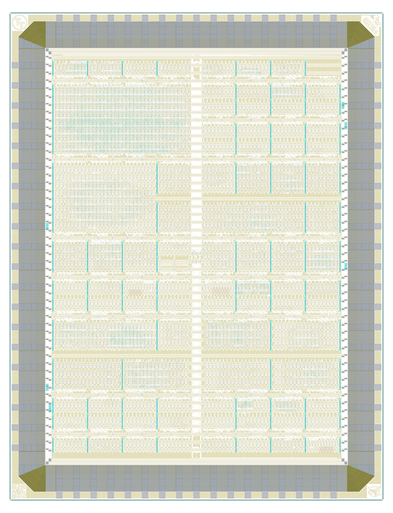

# Tiny Tapeout GF 26b on wafer.space Run 2

[Tiny Tapeout](https://tinytapeout.com/) chip [ttgf26b](https://tinytapeout.com/chips/ttgf26b), slot T26B of the [wafer.space GF180MCU Run 2](https://github.com/wafer-space/ws-run2) reticle (G802)

- Chip ID: ttgf26b
- wafer.space run: ws-run2 (G802), slot T26B
- Process: GF180MCU
- Number of projects: 90

<table width="100%">
  <tr>
  <td width="50%"></td>
  <td width="50%"></td>
  </tr>
</table>

This is one Tiny Tapeout die on a wafer.space shuttle; each project slot is a Tiny Tapeout project. See [PROVENANCE.md](PROVENANCE.md) for where the layout and project information come from.

# Projects

| Code | Project | Tiles | Author | Project Details | Repository |
|---|---|---|---|---|---|
| 000 | [Chip ROM](https://tinytapeout.com/chips/ttgf26b/tt_um_chip_rom) | 1x1 | Uri Shaked | ROM with information about the chip | https://github.com/TinyTapeout/tt-chip-rom |
| 001 | [Tiny Tapeout Factory Test](https://tinytapeout.com/chips/ttgf26b/tt_um_factory_test) | 1x1 | Tiny Tapeout | Factory test module | https://github.com/TinyTapeout/ttgf26a-factory-test |
| 003 | [TT-Arrakeen-SPSRAM-direct-sramrules](https://tinytapeout.com/chips/ttgf26b/tt_um_arrakeen_spsram_direct_sramrules) | 1x1 | Staf Verhaegen | Single port SRAM with pins connected directly to TT tile pins. | https://github.com/FibraServiTT/TTGF26b_Arrakeen_SPSRAM_direct_sramrules |
| 005 | [spiPWMio](https://tinytapeout.com/chips/ttgf26b/tt_um_fhw_appel_spiPWMio) | 1x1 | Sönke Appel | A PWM input and PWM generator are configurable via input pins, readable via output pins, and accessible via SPI for read and write operations. | https://github.com/FHW-Appel/TTgf26a-spiPWMio |
| 007 | [ECC Scalar Multiplication](https://tinytapeout.com/chips/ttgf26b/tt_um_ecc_scalar_mult) | 1x1 | Dhanush Kulkarni | Compact 8-bit ECC Scalar Multiplication Engine demonstrating scalar-point arithmetic for Tiny Tapeout. | https://github.com/CambridgeinstitutetechnologyBLR-Dhanush/ECC_Scalar_Multiplication |
| 032 | [8-bit Interactive ALU](https://tinytapeout.com/chips/ttgf26b/tt_um_alu) | 1x1 | Matanel Kadosh | An 8-bit Arithmetic Logic Unit with internal registers and multiplexed output for result/carry. | https://github.com/matanelk96/ASIC-ALU-MK |
| 033 | [60 Hz Grid-Forming ASIC with Dump-Load Control](https://tinytapeout.com/chips/ttgf26b/tt_um_60hz_load) | 1x2 | Eric Pearson | a CORDIC-locked grid-forming reference + linear dump-load controller ASIC for driving micro-inverters | https://github.com/ericpearson1313/tt_grid_tie_load |
| 034 | [Neuromorphic Spike Codec (GF180)](https://tinytapeout.com/chips/ttgf26b/tt_um_santhosh_spike_codec_gf) | 1x2 | Prof. Santhosh Sivasubramani, IIT Delhi | GF180mcuD digital neuromorphic spike codec: three encoders (rate via 8-bit Fibonacci LFSR, latency/time-to-first-spike, delta with programmable threshold) and three symmetric decoders (rate count, latency-to-value, signed delta-sigma accumulator with leak) in one SPI-programmable block; 1x2 tile, single-spike and bipolar spike outputs, window tick, busy/irq, 25 MHz signoff clock | https://github.com/SanthoshSivasubramani/tt_um_santhosh_spike_codec_gf_pub |
| 036 | [Neural Spike Detector](https://tinytapeout.com/chips/ttgf26b/tt_um_layla_spike_detector) | 1x2 | Layla Adeli | Adaptive neural spike detector with IIR bandpass filter (300-3000 Hz), Nonlinear Energy Operator (NEO), and EWMA adaptive threshold. Digital backend for neural recording AFEs. | https://github.com/laylaadeli7/tt_neural_spike_detection |
| 038 | [Lightscan](https://tinytapeout.com/chips/ttgf26b/tt_um_emiliopeju_lightscan) | 1x2 | Emilio Perez Juarez | BISS-C Position acquisition system for a scan with pulsed output. | https://github.com/EmilioPeJu/ttgf-lightscan |
| 039 | [ChaCha20](https://tinytapeout.com/chips/ttgf26b/tt_um_egurapha_chacha20) | 3x4 | Raphael Eguchi | RFC 8439 ChaCha20 stream-cipher core with a UART or parallel host interface | https://github.com/egurapha/ttgf-chacha20 |
| 065 | [TT-Arrakeen-SPSRAM-direct-5V](https://tinytapeout.com/chips/ttgf26b/tt_um_arrakeen_spsram_direct_5v) | 1x1 | Staf Verhaegen | Single port SRAM with pins connected directly to TT tile pins. | https://github.com/FibraServiTT/TTGF26b_Arrakeen_SPSRAM_direct_5V |
| 067 | [Car Trip](https://tinytapeout.com/chips/ttgf26b/tt_um_LukeSilva_cartrip) | 1x1 | Luke Silva | Let's go on a car trip (vga demo) | https://github.com/LukeSilva/tt-gf-car-trip |
| 069 | [triad01](https://tinytapeout.com/chips/ttgf26b/tt_um_Alanduan21_triad01_top) | 1x1 | Duan Yihe | A clocked failsafe arbitration block for autonomous drone control paths. Evaluates RC and FC health signals through temporal filtering and ternary inference to select PRIMARY / FALLBACK / SAFE_HOLD, driving a 50 Hz PWM output accordingly. Includes a scan chain for counter observability and lightweight LBIST for post-silicon diagnosis. Four operating modes: normal, PWM-test (pad loopback), scan, and LBIST. | https://github.com/Alanduan21/ttgf-triad01 |
| 071 | [4-Neuron LIF Spiking Neural Network](https://tinytapeout.com/chips/ttgf26b/tt_um_lif_snn) | 1x1 | Ilim Stankulov | A simple 4-neuron spiking neural network implementing the LIF model | https://github.com/ilim-stankulov/lif-spiking-neural-network |
| 096 | [Asynchronous-AER Spike Router (4-phase REQ/ACK, 16-entry routing table, GF180)](https://tinytapeout.com/chips/ttgf26b/tt_um_santhosh_aer_router_gf) | 1x2 | Prof. Santhosh Sivasubramani, IIT Delhi | GF180mcuD synchronous implementation of a 4-input / 4-output AER (address-event-representation) spike router. Time-multiplexed AER input and output buses each carry one event at a time as a 2-bit channel tag plus 6-bit address. Each incoming event is captured using a double-flop-synchronised 4-phase bundled-data REQ/ACK handshake, looked up in a 16-entry {dst_ch, dst_addr} routing table (or bypassed to pass through unchanged), queued in a 4-deep FIFO, and emitted out the output port with another 4-phase REQ/ACK handshake. Drops on FIFO overflow are counted in a 16-bit saturating drop counter with a sticky overflow_ever bit. Per-input 8-bit saturating event counters and IN_LAST / OUT_LAST debug latches are readable over SPI. 25 MHz signoff clock. | https://github.com/SanthoshSivasubramani/tt_um_santhosh_aer_router_gf_pub |
| 098 | [CIM Controller with BIST and Fault Map (GF180)](https://tinytapeout.com/chips/ttgf26b/tt_um_santhosh_cim_bist_gf) | 1x2 | Prof. Santhosh Sivasubramani, IIT Delhi | GF180mcuD digital compute-in-memory peripheral: 8x8 1-bit cell array with built-in self-test (march/checkerboard/diagonal patterns), 64-bit sticky fault map, 16-bit dot-product accumulator over user-programmable row activations, SPI-programmable, irq output, 25 MHz signoff clock, 1x2 tile | https://github.com/santhoshs93/tt_um_santhosh_cim_bist_gf_pub |
| 100 | [Neuromorphic PUF (distinct-tap LFSR arbiter + memristor XOR, GF180)](https://tinytapeout.com/chips/ttgf26b/tt_um_santhosh_neuro_puf_gf) | 1x2 | Prof. Santhosh Sivasubramani, IIT Delhi | GF180mcuD digital Physical Unclonable Function: 8 distinct-tap maximal-length 10-bit LFSRs act as synthesizable virtual ring-oscillators, a 6-bit challenge selects a pair, and an arbiter FSM compares their popcounts over a programmable 2^N-cycle window (N in 4..12) to produce a response bit. 64 challenges accumulate into a 64-bit response that can be XORed with a host-loaded memristor vector for dual-entropy mode. SPI-programmable, IRQ output, 25 MHz signoff clock, 1x2 tile (upsized from 1x1: global-placement utilization 103.6% on 1x1). | https://github.com/santhoshs93/tt_um_santhosh_neuro_puf_gf_pub |
| 101 | [AER Reflex Chip - MCP2515 CAN gateway](https://tinytapeout.com/chips/ttgf26b/tt_um_reflex_s4) | 3x2 | khu-haeun | Robot-arm reflex core: relays joint commands to CAN via an MCP2515, blocks the stream on a danger trigger and injects a reflex pose. Tuning values (recoil/speed/debounce) hardcoded; rules/threshold/flinch programmable. | https://github.com/khu-haeun/aer_reflex |
| 102 | [Wafer.space Logo VGA Screensaver](https://tinytapeout.com/chips/ttgf26b/tt_um_waferspace_vga_screensaver) | 1x2 | Uri Shaked | Wafer.space Logo bouncing around the screen (640x480, TinyVGA Pmod) | https://github.com/TinyTapeout/tt-waferspace-vga-screensaver |
| 103 | [Music for ASICs](https://tinytapeout.com/chips/ttgf26b/tt_um_d5smith_mfa) | 1x2 | d5smith | Autonomous generative ambient music chip using LFSR composition, scale quantization, and DDS synthesis | https://github.com/d5smith/tt_um_d5smith_mfa |
| 128 | [UART_SOC](https://tinytapeout.com/chips/ttgf26b/tt_um_uart_soc) | 1x1 | Siri Jagadeesh | Verifies firmware signature using a secure hash comparison module | https://github.com/sirijagadeesh4-hub/SIRI_UART_SOC |
| 129 | [CWRU CHIPS Simple Counter with 7-segment Display](https://tinytapeout.com/chips/ttgf26b/tt_um_cwru_cpu) | 1x2 | Andrew Chen, John Paul Magbitang | Simple counter demo on a RISC-V CPU with 7-segment display output | https://github.com/john-paul-sm/ASICWRU_SimpleCounter |
| 130 | [Raksha](https://tinytapeout.com/chips/ttgf26b/tt_um_raksha) | 1x1 | Sinchana | Secure Packet Authentication Engine for V2X Communication | https://github.com/shanthkumars165-commits/secure_packet_authentication |
| 132 | [8-bit WNN Pattern Recognizer](https://tinytapeout.com/chips/ttgf26b/tt_um_wnn) | 1x1 | Your Name | 8-bit Weightless Neural Network for pattern recognition using pattern matching. | https://github.com/cambridgeinstitutetechnology-blr-venkat/cit_project-2 |
| 134 | [Secure TRNG Entropy Generator](https://tinytapeout.com/chips/ttgf26b/tt_um_likitha_trng) | 1x1 | Likitha | Hardware entropy mixing circuit generating randomized outputs using XOR feedback paths | https://github.com/Cambridgeinstituteoftechnology-likitha/likii |
| 135 | [2048 sliding tile puzzle game (VGA)](https://tinytapeout.com/chips/ttgf26b/tt_um_2048_vga_game) | 3x2 | Uri Shaked | Slide numbered tiles on a grid to combine them to create a tile with the number 2048. | https://github.com/urish/tt-2048-game |
| 192 | [ECDSA Verification](https://tinytapeout.com/chips/ttgf26b/tt_um_ecdsa_verify) | 1x1 | Lyra | Simplified ECDSA digital signature verification module using Verilog | https://github.com/santoshism2006-pixel/vtox |
| 194 | [ECC Processor](https://tinytapeout.com/chips/ttgf26b/tt_um_ecc_processor) | 1x1 | Dhanush Kulkarni | Compact 8-bit ECC Processor demonstrating scalar-point arithmetic for TinyTapeout. | https://github.com/CambridgeinstitutetechnologyBLR-Dhanush/_ECC_Processor |
| 195 | [LEA-128](https://tinytapeout.com/chips/ttgf26b/tt_um_jct_lea) | 2x2 | awayzer JCT | iterative approach implementation of the LEA128 block cipher | https://github.com/awayzer/ttgf-jct-LEA128 |
| 196 | [Fast Authentication Accelerator](https://tinytapeout.com/chips/ttgf26b/tt_um_fast_auth) | 1x1 | Nagaraj | A hardware IP block that performs low-latency ECDSA verification for V2X communication. Authenticates digital signatures in under 1 ms, meeting IEEE 1609.2 automotive security requirements. | https://github.com/CambridgeinstitutetechnolgyBLR-Harshini/v2x_accelator |
| 198 | [TRNG using Ring Oscillator](https://tinytapeout.com/chips/ttgf26b/tt_um_karthik_trng) | 1x1 | Karthik | True Random Number Generator using ring oscillator | https://github.com/cambridgeinstituetechnologyBLR-karthikp/trng_ |
| 199 | [100Mpbs 3 port Ethernet switch](https://tinytapeout.com/chips/ttgf26b/tt_um_coffeepot) | 2x2 | Julia Desmazes | Unmanaged cut-though 3 port 100Mbps ethernet switch | https://github.com/Essenceia/ethernet_switch |
| 288 | [100Mbps Ethernet Accelerator Wrapper](https://tinytapeout.com/chips/ttgf26b/tt_um_teapot) | 1x2 | Julia Desmazes | Network connected accelerator wrapper, connected to custom bfloat16 multiplier. | https://github.com/Essenceia/Teapot |
| 295 | [ASCON Integrated Crypto Processor](https://tinytapeout.com/chips/ttgf26b/tt_um_mealycpp_ascon_sdmc_uart) | 4x4 | Dr. Mohamed El-Hadedy | AEAD-only SDMC ASCON cryptographic processor with UART command/control, using the CISC-style AEAD core. HASH, XOF, CXOF, and chain modes are intentionally excluded from this branch. | https://github.com/mealycpp/tt-ascon-full |
| 352 | [Procedural ASIC](https://tinytapeout.com/chips/ttgf26b/tt_um_connerdaehler_boop) | 1x2 | Conner Daehler | animated procedural graphics using XOR and arithmetic patterns | https://github.com/wiredlab/daehler-procedural_graphics_core |
| 353 | [ttgf jct PoC](https://tinytapeout.com/chips/ttgf26b/tt_um_JCT_PoC) | 1x1 | awayzer JCT | Naive and very simple implementation of a stream cipher | https://github.com/awayzer/ttgf-jct-PoC |
| 354 | [PWM-Analyser](https://tinytapeout.com/chips/ttgf26b/tt_um_PaulineKreis_PWM_Analyser) | 1x2 | Pauline Kreis, Muhammad Saim Bilal | Analyses PWM signal and delivers duty Cycle and frequency measurements on a 7-segment display | https://github.com/PaulineKreis/TTGF26b_PWM-Analyser |
| 355 | [CORDIC sin/cos generator](https://tinytapeout.com/chips/ttgf26b/tt_um_jte_cordic) | 1x1 | Jacques Te | Computes the sine and cosine of an 8-bit input angle using an iterative 8-stage CORDIC algorithm in Q2.6 fixed-point. | https://github.com/JacquesBTe/tt_um_jte_cordic |
| 356 | [Arctic0 16-bit CPU](https://tinytapeout.com/chips/ttgf26b/tt_um_Arctic0) | 1x2 | Einosuke Okazaki | 16-bit multi-cycle CPU: SPI flash instructions, SPI SRAM data, UART TX/RX, GPIO and register dump | https://github.com/PenguinEino/Arctic0 |
| 357 | [Three Channel RGB PWM Controller](https://tinytapeout.com/chips/ttgf26b/tt_um_aidenkoch4) | 1x1 | Aiden Koch | Red Green Blue compatable Pulse Width Modulator to control effective voltages at an LED to control the color output. User defiend clock divider included to increase range of application usage. | https://github.com/aidenkoch4/ece430-tt-GF26A |
| 358 | [Pong](https://tinytapeout.com/chips/ttgf26b/tt_um_ljhahne_pong) | 1x2 | Lukas Hahne | Simple implementation of Pong | https://github.com/ljhahne/ttgf-pong |
| 359 | [Tremolo guitar pedal ASIC](https://tinytapeout.com/chips/ttgf26b/tt_um_pschuetz_tremolo) | 1x1 | Preston Schuetz | This is a PWM controller for a tremolo guitar pedal | https://github.com/Pschuetz112/tt-guitar-pedal-tremolo_final |
| 385 | [PWM Generator](https://tinytapeout.com/chips/ttgf26b/tt_um_PWM) | 1x1 | Omar, Nitin | A PWM generator with configurable period and duty cycle via 8-bit input pins | https://github.com/Omar90551/TTGF-PWM |
| 386 | [Elemental Harmony Game](https://tinytapeout.com/chips/ttgf26b/tt_um_elemental_harmony) | 2x2 | Aakarshitha Suresh | Elemental Harmony is a silicon-based 4 * 4 strategy game, like Tic-Tac-Toe, where players compete against a logic engine to score points by matching elemental patterns across a digital grid. | https://github.com/Aakarshitha/Elemental_Harmony_GF26b |
| 387 | [WashingMachine_FSM](https://tinytapeout.com/chips/ttgf26b/tt_um_KimLuu02_WashingMachine_FSM) | 1x1 | Charithma Perera, Kim Luu | Washing Machine Control | https://github.com/KimLuu02/TTGF26b_WashingMachine-FSM |
| 389 | [Traffic Light FSM](https://tinytapeout.com/chips/ttgf26b/tt_um_Kieckenwama_Traffic_LIGHT_FSM) | 1x1 | Eric Kiecksee | Simple traffic light FSM for intersection with main road, side road and pedestrian phases | https://github.com/Kieckenwama/TTGF26b_Traffic_Ligth_FSM |
| 390 | [Smerity-Mandelbrot](https://tinytapeout.com/chips/ttgf26b/tt_um_smerity_mandelbrot) | 2x2 | Stephen Merity | An interactive fixed-point Mandelbrot iterator with a sequential (bit-serial) multiplier. Tested on iCEBreaker FPGA V1.1a. | https://github.com/Smerity/tt_um_smerity_mandelbrot |
| 391 | [fibbonaci_tt](https://tinytapeout.com/chips/ttgf26b/tt_um_jsabree11_fibonacci_checker) | 1x1 | Jake Sabree | Checks if a user input number is in the fibbonaci sequence | https://github.com/wiredlab/sabree-fibonacci_tt |
| 449 | [Simple Sprinkler](https://tinytapeout.com/chips/ttgf26b/tt_um_wokwi_466666882406199297) | 1x1 | Noah Perez | I designed a Binary to Hexidecimal Decoder using a seven-segment LED display that takes inputs A - D and outputs a hexidecimal value between 1 - F. | https://github.com/noahzperez29/Noah_Binary_Hex_Decoder |
| 450 | [Programmable Waveform and PWM Generator](https://tinytapeout.com/chips/ttgf26b/tt_um_pattern_gen) | 2x2 | silicon_nomad | UART-programmable waveform and PWM generator. Send samples over UART, stored in 256-byte RAM, played back as 8-bit parallel DAC output or 8 independent PWM channels. | https://github.com/silicon-nomad/tt-programmble-tiny-pattern-gen |
| 451 | [Universal Binary to Segment Decoder](https://tinytapeout.com/chips/ttgf26b/tt_um_rebeccargb_universal_decoder) | 1x1 | Rebecca G. Bettencourt | Decodes various binary codes to various segmented displays. | https://github.com/RebeccaRGB/ttgf-ubcd |
| 453 | [Hardware UTF Encoder/Decoder](https://tinytapeout.com/chips/ttgf26b/tt_um_rebeccargb_hardware_utf8) | 1x1 | Rebecca G. Bettencourt | Converts Unicode code points between UTF-8, UTF-16, and UTF-32. | https://github.com/RebeccaRGB/ttgf-hardware-utf8 |
| 454 | [Spiking Neural Network WTA Inference Engine (GF180)](https://tinytapeout.com/chips/ttgf26b/tt_um_santhosh_snn_wta_gf) | 2x2 | Prof. Santhosh Sivasubramani, IIT Delhi | GF180mcuD digital spiking neural network inference engine: 4 LIF neurons with programmable 4x4 signed synaptic weight matrix, per-neuron bias, programmable global threshold/leak/refractory, hard winner-take-all lateral inhibition, optional self-recurrence, SPI-configurable 16-bit register file, 4-channel 2-bit input current coding, 4 spike outputs, 2-bit winner ID output, any-spike and busy flags; deterministic single-cycle neuron update | https://github.com/ragansanthosh/tt_um_santhosh_snn_wta_gf_pub |
| 455 | [SPI Master Slave Communication](https://tinytapeout.com/chips/ttgf26b/tt_um_spi_master) | 1x1 | Nevin Philip | 8-bit Full Duplex SPI Communication using Master and Slave | https://github.com/nev-1910/SPI |
| 480 | [Configurable 8-bit PWM Generator](https://tinytapeout.com/chips/ttgf26b/tt_um_pwm_cit) | 1x1 | Vinuta | Generates a variable duty cycle PWM signal using an 8-bit input. | https://github.com/Cambridge-CIT-ASIC-Tapeouts/PWM |
| 481 | [Secure V2X Mini Demonstrator](https://tinytapeout.com/chips/ttgf26b/tt_um_push) | 1x1 | Pushkar Kulkarni | 8-bit LFSR based data masking for secure V2X communication | https://github.com/push-777/Sanpush_ALU |
| 482 | [Digital Door Lock](https://tinytapeout.com/chips/ttgf26b/tt_um_rameshwar_door_lock) | 1x1 | Rameshwar | Digital door lock system using password verification. | https://github.com/Rameshwar-12/Door_lock_system |
| 483 | [AES S-Box Accelerator](https://tinytapeout.com/chips/ttgf26b/tt_um_santosh_aes_sbox) | 1x1 | Santosh | Design and Physical Implementation of AES S-Box Accelerator using SKY130 OpenLane Flow | https://github.com/cambridgeinstitutetechnologyblr-santosh/sanpush_aes |
| 484 | [8-bit LFSR Circuit](https://tinytapeout.com/chips/ttgf26b/tt_um_sandy_venky) | 1x1 | Satya Roop Bankuru | Sequential PRNG block using Verilog. | https://github.com/CambridgeinstitutetechnologyBLR-satya/lfsrvenkys |
| 485 | [Hardware Anomaly Detection](https://tinytapeout.com/chips/ttgf26b/tt_um_hardware_anomaly_detection) | 1x1 | Vinayak | ML-based V2X hardware anomaly detection engine. | https://github.com/vinayakalk25/Hardware_abnormal_detection |
| 486 | [V2X Collision Warning](https://tinytapeout.com/chips/ttgf26b/tt_um_v2x_warning) | 1x1 | PM Likhith Kumar | Simple V2X collision warning system using Verilog | https://github.com/Cambridge-CIT-ASIC-Tapeouts/V2X_Collision_Warning_system |
| 487 | [Multi-Protocol Communication Controller](https://tinytapeout.com/chips/ttgf26b/tt_um_multi_protocol) | 1x1 | Chirantan J Tilavalli | Supports UART, SPI and I2C transmission modes using a compact single-module design. | https://github.com/CambridgeinstituteoftechnologyBLR-chiru/Communication-protocol |
| 512 | [SPI Slave with 8-Register File](https://tinytapeout.com/chips/ttgf26b/tt_um_spi_slave) | 1x1 | Usha | An industry-grade SPI slave peripheral with an internal 8-byte register file | https://github.com/Ushaop-op/ttgf-spi |
| 513 | [Project](https://tinytapeout.com/chips/ttgf26b/tt_um_ex_drosen766) | 1x1 | DHR | Description of project | https://github.com/DRosen766/ttgf-26b |
| 514 | [4 bit Accumulator CPU](https://tinytapeout.com/chips/ttgf26b/tt_um_4b_accumulator_cpu) | 1x1 | Darshan | A minimal 4-bit accumulator-driven CPU where each instruction from ROM operates on the accumulator via an ALU (ADD, SUB, AND, OR), with the accumulator storing the result of each operation for the next cycle. | https://github.com/Cambridge-CIT-ASIC-Tapeouts/ttgf-4b-accumulator-cpu |
| 515 | [Simple SPI configuration for analog designs](https://tinytapeout.com/chips/ttgf26b/tt_um_spi_config_reg) | 1x1 | Alan G | Simple 8-bit unidirectional SPI register for external configuration of future analog/mixed-signal designs | https://github.com/agurlask/ttgf26b-spi-config-reg |
| 516 | [Programmable Chaotic NLFSR](https://tinytapeout.com/chips/ttgf26b/tt_um_cambridge_nlfsr) | 1x1 | Aishu | A 16-bit NLFSR with two switchable non-linear feedback functions for cryptographic chaos. | https://github.com/CambridgeinstitutetechnologyBLR-Aishu/CIT_Programmable-NLFSR |
| 517 | [I2C Slave Template with Emulated Sensor](https://tinytapeout.com/chips/ttgf26b/tt_um_BastiBudde_i2c_slave_sensor) | 1x1 | Sebastian Budde, Janina Speckmann | I2C slave (tested up to FM+) with eight writable registers and eight read-only registers fed by an internal LFSR that emulates a sensor - a reusable template for a real I2C sensor. | https://github.com/BastiBudde/TTSky26b_I2C-Slave-Sensor |
| 518 | [PQC NTT Butterfly Core](https://tinytapeout.com/chips/ttgf26b/tt_um_pqc_ntt_butterfly) | 1x1 | Aishwarya Gadela & Bojji Reddy Rishika | Hardware-accelerated Cooley-Tukey NTT Butterfly processing block for PQC Kyber | https://github.com/bojjireddyrishika12-web/butterfly |
| 519 | [BSD Convolution Adder Tree](https://tinytapeout.com/chips/ttgf26b/tt_um_Vincent2405_adder_tree) | 1x1 | Vincent Mertens | Multiplierless shift-add tree for image convolution | https://github.com/Vincent2405/BSD-Convolution-Adder-Tree-TinyTapeout |
| 545 | [Quadrature sine generator](https://tinytapeout.com/chips/ttgf26b/tt_um_franretfie_top) | 1x1 | Framcesco Osti | A Quadrature Sine Direct Digital Synthetizer with PCM outputs | https://github.com/fran-retfie/GF26b-qsdss |
| 547 | [Tiny RIng Oscillator PUF](https://tinytapeout.com/chips/ttgf26b/tt_um_ro_puf) | 1x1 | Manuel Roales | A Ring Oscillators PUF wit programmable characteristics | https://github.com/mRoales/Programmable_Ring_Oscillator_PUF |
| 549 | [Detronyx UART Trace Exerciser](https://tinytapeout.com/chips/ttgf26b/tt_um_detronyx_uart_trace_exerciser) | 1x1 | Detronyx contributors | UART-controlled pattern generator and streaming trace/event analyzer | https://github.com/Zhekar1998/tt_um_detronyx_uart_trace_exerciser |
| 551 | [BRISQ](https://tinytapeout.com/chips/ttgf26b/tt_um_brisq) | 1x1 | Poiku | BRISQ: Binary Reduced Inverse SQrt | https://github.com/pratyaygopal/BRISQ |
| 576 | [4-bit Maximum-Length LFSR](https://tinytapeout.com/chips/ttgf26b/tt_um_geeta_doddamani_lfsr) | 1x1 | Geeta Doddamani | A 4-bit maximum-length LFSR with seed 0x1 and feedback polynomial x4+x+1. Generates pseudo-random sequence of period 15. | https://github.com/Geeta-doddamani/ttgf-lfsr |
| 577 | [SPI-CPU](https://tinytapeout.com/chips/ttgf26b/tt_um_spi_cpu_top) | 1x1 | MS College of Engineering | A 4-bit CPU using the SPI Flash RAM from the QSPI PMOD to load programs. | https://github.com/cyrilprasannarajp/tt_MS_Engg_Clg_SPI |
| 578 | [ECC Scalar Accelerator](https://tinytapeout.com/chips/ttgf26b/tt_um_ecc_accelerator) | 1x1 | PM LIKHITH KUMAR AND PRAJWAL T | Simplified ECC accelerator using Verilog HDL for ASIC implementation | https://github.com/pmlikhithkumar55-ship-it/CIT_AMG |
| 579 | [I2C Master Controller](https://tinytapeout.com/chips/ttgf26b/tt_um_i2c_master) | 1x1 | Akshaya Institute of Technology | Simple I2C Master Controller that transmits one byte to a fixed slave address (0x50). Generates START and STOP conditions and provides BUSY, DONE, and ACK status outputs. | https://github.com/abhilash0419/tt_Akshaya_Ins_of_Tech_I2C |
| 580 | [Configurable PWM Generator](https://tinytapeout.com/chips/ttgf26b/tt_um_configurable_pwm) | 1x1 | Shivaranjani GR, Ganesh Ragava, Sidharth Kamalakkannan | A PWM generator featuring run-time variable period, duty cycle, and output polarity controls with built-in safety clamps. | https://github.com/ShivaranjaniGR/ePWM_Tapeout |
| 581 | [Aswarby INT8 MAC](https://tinytapeout.com/chips/ttgf26b/tt_um_aswarby_mac) | 1x1 | Mark Shilton | Byte-serial weight-stationary signed INT8 multiply-accumulate engine | https://github.com/markd666/tt-aswarby-mac |
| 582 | [8-bit Comparator](https://tinytapeout.com/chips/ttgf26b/tt_um_comp8) | 1x1 | Nagaraj | Compares two 8-bit inputs and indicates equal, greater than, or less than. | https://github.com/Cambridge-CIT-ASIC-Tapeouts/VLSI-project |
| 583 | [TT-Arrakeen-SPSRAM-direct](https://tinytapeout.com/chips/ttgf26b/tt_um_arrakeen_spsram_direct) | 1x1 | Staf Verhaegen | Single port SRAM with pins connected directly to TT tile pins. | https://github.com/FibraServiTT/TTGF26b_Arrakeen_SPSRAM_direct |
| 608 | [7SegmentDice](https://tinytapeout.com/chips/ttgf26b/tt_um_elvtide01_7SegmentDice) | 1x1 | Jannis Rohleder, Aishwarya Kanade | 6-sided electronic dice with 7-Segment Display output | https://github.com/elvtide01/7SegmentDice |
| 609 | [XORing given bits](https://tinytapeout.com/chips/ttgf26b/tt_um_cherny_xor_8bi) | 1x1 | Jan Cerny | Oputpus is a XOR of ui_in and previously configured address | https://github.com/cherny1001/ttgf-26b |
| 610 | [PDM Voice Activity Detector](https://tinytapeout.com/chips/ttgf26b/tt_um_antimatter15_pdm_vad) | 1x1 | Kevin | A one-tile spectral PDM voice activity score. | https://github.com/antimatter15/ttgf26-vad |
| 611 | [PolyTrig Digital Waveform Synthesis Core](https://tinytapeout.com/chips/ttgf26b/tt_um_polytrig_core) | 1x1 | Saeed Seyedfaraji | Compact ASIC-oriented digital waveform synthesis engine supporting LUT-based trigonometric reconstruction, waveform generation, and NCO-style signal synthesis. | https://github.com/SaeedSeyedfaraji/tt_um_polytrig_core_gf |
| 612 | [Detronyx Arithmetic Lab Tile](https://tinytapeout.com/chips/ttgf26b/tt_um_detronyx_arith_lab) | 1x1 | Detronyx contributors | Register-loaded add/multiply/divide arithmetic lab for TinyTapeout GF | https://github.com/Zhekar1998/tt_um_arith_lab |
| 613 | [Simon Says memory game](https://tinytapeout.com/chips/ttgf26b/tt_um_urish_simon) | 1x1 | Uri Shaked | Repeat the sequence of colors and sounds to win the game | https://github.com/urish/tt-simon-game |
| 614 | [Nearest Neighbor Interpolation](https://tinytapeout.com/chips/ttgf26b/tt_um_hasheddan_nni) | 1x1 | Dan Mangum | Nearest neighbor interpolation demosaicing for RGGB Bayer CFAs over UART | https://github.com/hasheddan/nni |

The code is the project's Tiny Tapeout multiplexer address.

# View the Layout

1. To view the layout, please install [KLayout](https://www.klayout.de/).
2. Next, assemble `T26B.oas` from the individual files: `cd layout; cat T26B-part-?? >T26B.oas`
3. The assembled `T26B.oas` file can then be opened with KLayout.
4. Finally, load the layer properties file in KLayout: "File → Load Layer Properties" and choose `lyp/gf180mcu.lyp` at the top of this repository.

Note: The `T26B.oas` file was split with `split -b 90M T26B.oas T26B-part-`

# License

The projects shown here are public. For information on licences, please refer to the individual repositories.
